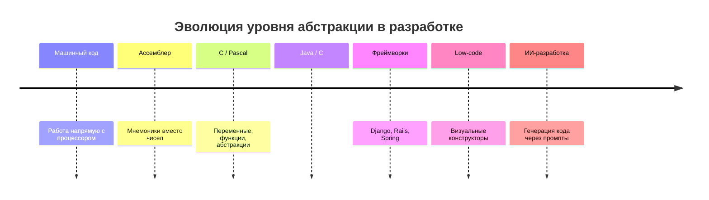

# Эволюция языков программирования: от машинного кода до ИИ-разработки

История программирования — это не только про технологии. Это ещё и бесконечная драма, в которой каждое новое поколение инструментов объявляют «игрушками», а их пользователей — «не настоящими программистами».

Почти каждый раз история показывает: новые подходы не упрощают профессию до примитивного уровня — они **поднимают уровень абстракции**, оставляя сложность на месте.

## Эпоха 1: Машинный код и ассемблер

Самое начало. Программист:

- работал напрямую с инструкциями процессора
- управлял памятью вручную
- писал код, максимально близкий к железу

Ассемблер стал первым «упрощением». Реакция «старой школы» тогда звучала примерно так:

> «Настоящие программисты пишут в машинных кодах. Ассемблер — это уже костыль.»

Аргументы были знакомые: «ты не понимаешь, что происходит на самом деле», «это снижает контроль», «так нельзя писать серьёзные системы».

Ирония в том, что ассемблер в итоге стал стандартом на долгие годы.

## Эпоха 2: Высокоуровневые языки (C, Pascal и другие)

Появляются языки, где есть переменные, функции, абстракции. Программист больше не думает в регистрах и переходах.

Реакция:

> «Это всё игрушки. Там нет контроля над памятью. Это для студентов.»

Потом приходит язык C — и внезапно операционные системы, компиляторы, серьёзные продукты начинают писаться на нём.

## Эпоха 3: Управляемые среды и ООП (Java, C#, Python)

Следующий скачок: сборка мусора, классы, абстракции поверх абстракций.

И снова:

> «Это медленно. Это неэффективно. Настоящие системы так не пишут.»

Тем временем корпоративные системы, веб-сервисы, огромные платформы спокойно живут на этих «несерьёзных» технологиях.

## Эпоха 4: Фреймворки и высокоуровневые экосистемы

Здесь начинается настоящий культурный кризис. Появляются Django, Rails, Spring. Теперь разработчик не пишет всё с нуля, использует готовые решения, работает на уровне бизнес-логики.

Реакция:

> «Вы вообще не понимаете, как это работает внутри. Это магия, а не программирование. В продакшене такое не живёт.»

::: details Как всё было на самом деле
Спойлер: живёт. И ещё как. Фреймворки стали стандартом индустрии, а «настоящие программисты», писавшие всё с нуля, оказались в меньшинстве.
:::

## Эпоха 5: Low-code / No-code

Тут у многих окончательно сдают нервы:

> «Теперь уже точно всё, профессия умерла.»

Но реальность: сложные системы по-прежнему требуют инженеров. Просто часть задач уходит на более высокий уровень.

## Эпоха 6: Программирование с помощью ИИ

И вот мы здесь. Теперь разработчик может генерировать код, анализировать ошибки, проектировать системы в диалоге.

Реакция «старой школы» звучит подозрительно знакомо:

> «Это не программирование. Они ничего не понимают. ИИ всё делает за них.»

История буквально повторяется. Даже формулировки не меняются.

## Почему это происходит каждый раз

Потому что с каждым новым уровнем абстракции:

- **снижается порог входа**
- **увеличивается скорость разработки**
- **меняется роль программиста**

И это пугает тех, кто инвестировал годы в старый стек и строил идентичность вокруг «сложности».

## Что на самом деле меняется

Не сложность. Меняется **её расположение**.

Раньше сложность была в синтаксисе и низком уровне. Теперь — в архитектуре, в управлении системой, в принятии решений.

## Почему ИИ — текущая вершина эволюции

Потому что он делает следующий логичный шаг: убирает необходимость писать большую часть кода вручную.

Но:

- не убирает необходимость думать
- не убирает архитектуру
- не убирает ответственность

ИИ ускоряет реализацию, помогает исследовать решения, снижает рутину.

## Иллюзия «это стало проще»

Снаружи кажется: «ну теперь-то любой может программировать».

На практике:

- **Без подготовки:** хаотичный код, отсутствие структуры, зависимость от генерации
- **С подготовкой:** быстрые и качественные системы, контроль архитектуры, предсказуемость

::: details Почему грамотный подход может быть таким же сложным, как машинный код
Высокий уровень абстракции не убирает сложность — он требует более высокого уровня мышления.

Работа с ИИ на серьёзном уровне включает:

- управление контекстом
- формализацию задач (spec-first)
- декомпозицию систем
- контроль архитектуры
- проверку результатов

Это не «написал промпт и пошёл пить кофе». Это инженерная работа, просто на другом уровне.
:::

## Итог

Каждое поколение инструментов: сначала высмеивается, потом принимается, потом становится стандартом.

Программирование с помощью ИИ — не исключение. Это не «упрощение профессии». Это её **следующая форма**.

Те, кто адаптируются, получают преимущество. Те, кто отрицают, остаются спорить с реальностью. А сложность никуда не делась — она просто переехала туда, где без мышления уже не выжить.
