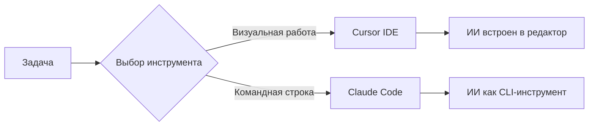

# Claude Code: ИИ прямо в терминале

Если Cursor — это привычная IDE с прокачанным ИИ, то Claude Code — это другая философия: **минимум интерфейса, максимум контроля**.

И да, он работает в терминале. Прямо там, где у многих заканчивается зона комфорта.

## Что такое Claude Code

Claude Code — это инструмент для разработки с использованием ИИ, который работает через командную строку.

То есть:

- никакого полноценного GUI
- никакого «редактора с вкладочками»
- взаимодействие через команды и текст

Зато:

- полный контроль над процессом
- гибкость
- возможность встроить в свой привычный workflow

## В чём ключевое отличие от Cursor



| Критерий | Cursor                      | Claude Code                   |
| -------- | --------------------------- | ----------------------------- |
| Среда    | Визуальная IDE              | Терминал                      |
| Подход   | ИИ встроен в редактор       | ИИ как CLI-инструмент         |
| Стиль    | Работа «рядом с кодом»      | Работа «через команды»        |
| Контроль | Больше магии, меньше рутины | Меньше магии, больше контроля |

Проще: Cursor — это «разработка с ИИ в редакторе». Claude Code — это «ИИ как часть системы разработки».

## Как используется Claude Code

Типичный сценарий:

```bash
claude "объясни, почему падает этот сервис"
```

Или:

```bash
claude "сгенерируй функцию для обработки платежей"
```

Или даже:

```bash
cat main.py | claude "найди баги и предложи исправления"
```

То есть можно работать с файлами, пайпить данные, встраивать в скрипты. Это уже ближе к инженерии, чем к «поболтать с чатиком».

## Плюсы Claude Code

### 1. Гибкость

Легко встраивается в CLI, можно автоматизировать, можно комбинировать с другими инструментами.

### 2. Контроль

Ты явно задаёшь, что передаётся в контекст. Меньше «магии».

### 3. Скорость для опытных пользователей

Если ты живёшь в терминале — это быстрее, чем кликать мышкой.

## Минусы Claude Code

### 1. Порог входа

Если терминал для тебя — это «чёрное окно страха», будет больно.

### 2. Нет визуального контекста

Не видно проект целиком, нет удобной навигации, всё нужно держать в голове.

### 3. Требует дисциплины

Нужно самому управлять контекстом. Легко наделать глупостей.

## Cursor vs Claude Code: что выбрать

::: info
**Cursor лучше, если:** вы работаете с большим проектом, важна визуальная навигация, нужен быстрый старт.

**Claude Code лучше, если:** вы любите терминал, хотите автоматизировать процессы, работаете с отдельными задачами или скриптами.
:::

Нормальная практика — использовать оба подхода: Cursor для основной разработки, Claude Code для точечных задач и автоматизации.

## Установка Claude Code

### Общая идея

Claude Code устанавливается как CLI-инструмент — чаще всего через пакетный менеджер или через npm.

### Установка на Windows

Если у вас установлен Node.js:

```bash
npm install -g @anthropic-ai/claude-code
```

После установки команда `claude` станет доступна в терминале (PowerShell, CMD или WSL).

### Установка на macOS

```bash
brew install claude-code
```

или через npm:

```bash
npm install -g @anthropic-ai/claude-code
```

### Установка на Linux

Через npm:

```bash
npm install -g @anthropic-ai/claude-code
```

## Активация и доступ

После установки Claude Code обычно предлагает войти в аккаунт или автоматически подхватывает авторизацию.

::: details Что делать, если нет аккаунта Claude
В рамках обучения — если вам не выдали аккаунт Claude, ничего дополнительно настраивать не нужно. Основная работа будет вестись через Cursor.
:::

## Итог

**Claude Code — это:**

- ИИ в терминале
- максимум гибкости
- минимум интерфейса

**Cursor — это:**

- ИИ в IDE
- удобство
- быстрый старт

Лучший инструмент — это не «самый модный», а тот, который даёт тебе контроль и скорость одновременно.
