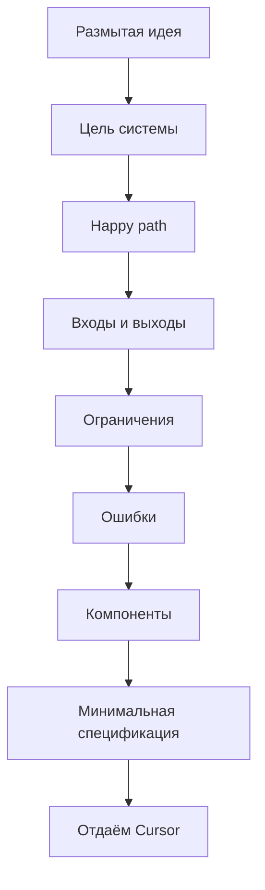

# Как сгенерировать базовую спецификацию, если проект туманный, а ТЗ не существует

Иногда проект начинается не с чёткого технического задания, а с формулировки уровня: «нужно что-то вроде сервиса… ну, чтобы работало». Поздравляю, вы в реальном мире разработки.

Хорошая новость: даже в таких условиях можно (и нужно) выстроить базовую спецификацию, с которой уже можно нормально работать в Cursor.

## Зачем вообще нужна спецификация, если «и так можно начать писать код»

Потому что без неё происходит следующее:

- требования плавают каждый час
- архитектура меняется на ходу
- ИИ начинает «додумывать продукт» за вас
- код быстро превращается в хаос

::: danger
Базовая спецификация — это не бюрократия. Это способ зафиксировать хоть какую-то опору.
:::

## Принцип: от размытого к конкретному

Если нет ТЗ, ваша задача — **сжать неопределённость** до минимально понятной формы.

Не нужно пытаться сразу описать идеальную систему. Нужно ответить на несколько ключевых вопросов.



## Шаг 1. Сформулируйте цель системы

Начните с одной простой формулировки:

```
Цель: что делает система и для кого
```

Примеры:

- «Сервис для учёта личных финансов»
- «API для обработки платежей»
- «Инструмент для анализа логов»

Важно: без деталей реализации, без «AI-powered blockchain future», просто суть.

## Шаг 2. Определите основной сценарий (happy path)

Ответьте: что происходит, если всё идёт правильно?

```
Сценарий:
1. пользователь делает X
2. система делает Y
3. результат Z
```

Пример:

1. Пользователь отправляет платёж
2. Система валидирует данные
3. Платёж проводится
4. Возвращается статус успеха

Это уже даёт Cursor понимание логики.

## Шаг 3. Опишите входы и выходы

Минимально, но конкретно:

```
Вход:
- user_id: string
- amount: decimal

Выход:
- status: success | error
- transaction_id: string
```

Не нужно идеальной схемы. Нужно, чтобы это было **не «что-то там»**, а структура.

## Шаг 4. Добавьте базовые ограничения

Это место, где большинство ленится, а потом страдает.

```
Ограничения:
- таймауты
- лимиты
- идемпотентность
- требования к безопасности
```

Пример: не более 3 попыток, таймаут 5 секунд, проверка входных данных.

Даже такие простые вещи резко улучшают результат генерации.

## Шаг 5. Зафиксируйте ошибки

ИИ очень любит игнорировать негативные сценарии. Не давайте ему такой роскоши.

```
Ошибки:
- invalid_input
- timeout
- not_found
```

Это сразу делает систему «живой», а не игрушечной.

## Шаг 6. Сформируйте минимальную архитектуру

Не надо рисовать UML на 40 страниц. Достаточно:

```
Компоненты:
- API
- бизнес-логика
- хранилище
```

И кратко: кто за что отвечает.

## Шаг 7. Отдайте это Cursor и уточняйте

Первый запрос может быть таким:

```
Вот базовая спецификация.
Задача:
1. найди слабые места
2. задай уточняющие вопросы
3. предложи улучшения без усложнения
```

::: success
Это критически важный шаг. ИИ найдёт дыры, предложит edge-case'ы, поможет уточнить модель.
:::

## Шаг 8. Только потом — генерация кода

И только после этого:

```
Реализуй [конкретный модуль] строго по спецификации.
```

Не раньше.

## Минимальный шаблон спецификации

Можно использовать как заготовку:

```
Цель:

Сценарий (happy path):

Вход:

Выход:

Ограничения:

Ошибки:

Компоненты:
```

Этого уже достаточно, чтобы избежать хаоса, получить осмысленный код и не переписывать всё через два дня.

## Итог

Если нет ТЗ — вы сами его создаёте. Быстро, минимально, но структурированно.

Это превращает работу с Cursor из «сгенерируй мне что-нибудь» в «реализуй конкретную систему с понятными правилами».

И внезапно ИИ начинает выглядеть умнее. Хотя, если честно, он просто перестаёт бороться с неопределённостью, которую ему подкинули.
