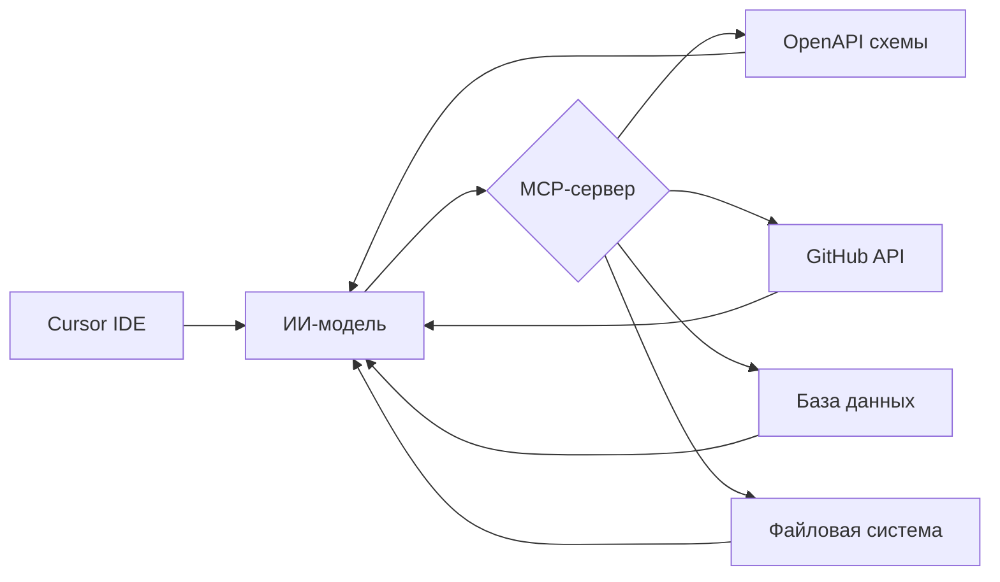

# Подключение стороннего MCP-сервера в Cursor

Cursor сам по себе уже «умный», но иногда этого недостаточно. Хочется, чтобы ИИ не просто генерировал код, а **работал с внешними инструментами, API и данными**.

Вот тут и появляется MCP.

## Что такое MCP

MCP (Model Context Protocol) — это способ подключить к ИИ внешние источники данных и инструменты.

Проще: **MCP-сервер = мост между ИИ и внешним миром**.

С его помощью ИИ может:

- читать документацию
- дергать API
- работать с файлами
- использовать внешние сервисы

И всё это — прямо из Cursor.



## Зачем это нужно на практике

**Без MCP:**

- ИИ «вспоминает» API
- иногда ошибается
- иногда устаревает

**С MCP:**

- ИИ **обращается к реальному источнику**
- работает с актуальными данными
- перестаёт гадать

## Пример: фронтенд-разработка

Допустим, ты пишешь фронтенд.

Обычный сценарий: «сгенерируй компонент под API». ИИ придумывает структуру — иногда угадывает, иногда нет.

С MCP: ИИ реально читает OpenAPI или документацию. И генерирует точные типы, делает корректные запросы, учитывает реальные поля.

## Примеры реальных MCP-серверов

### 1. MCP для OpenAPI

Что даёт: подключение к OpenAPI-схемам, генерация клиентов, анализ API.

> «Возьми этот openapi.json и сгенерируй frontend client»

### 2. MCP для GitHub

Что даёт: доступ к репозиториям, чтение кода, анализ PR.

Можно анализировать чужой код, генерировать изменения, работать с issue.

### 3. MCP для баз данных

Что даёт: доступ к реальной БД, чтение схем, генерация запросов.

Полезно для генерации backend-кода или синхронизации frontend с данными.

### 4. MCP для документации

Что даёт: доступ к локальным файлам, чтение markdown, использование docs/ как контекста.

::: success
ИИ реально читает твою документацию, а не «вспоминает её».
:::

## Как подключить MCP в Cursor

### Шаг 1. Установить MCP-сервер

Обычно это npm-пакет или отдельный сервис. Пример:

```bash
npm install -g @modelcontextprotocol/server-openapi
```

### Шаг 2. Запустить сервер

```bash
openapi-mcp-server --port 3000
```

### Шаг 3. Подключить в Cursor

В Cursor:

1. Открыть настройки
2. Найти раздел MCP / Tools / Integrations
3. Добавить новый сервер

Указать URL (например, `http://localhost:3000`) и тип сервера.

### Шаг 4. Проверить

После подключения можно писать:

> «Используй MCP и посмотри API»
> «Сгенерируй клиент на основе схемы»

Если всё настроено правильно — ИИ начнёт реально использовать данные.

## Как это выглядит в работе

Ты пишешь: «сгенерируй React hook для получения списка пользователей»

ИИ:

1. Идёт в MCP
2. Читает OpenAPI
3. Генерирует правильные типы, правильные endpoint'ы, корректную обработку

И это уже не «угадайка».

## Плюсы и минусы MCP

**Плюсы:**

- актуальные данные
- меньше галлюцинаций
- интеграция с реальными системами
- автоматизация

**Минусы:**

- требуется настройка
- возможные баги
- не все серверы стабильны
- нужно понимать, что подключаешь

## Итог

MCP — это шаг от «ИИ что-то генерирует» к «ИИ реально работает с системой».

Особенно это полезно:

- во фронтенде (API, типы)
- в интеграциях
- в сложных проектах

::: info
Без MCP ИИ — это очень умный собеседник. С MCP ИИ — это уже инструмент, который что-то делает.

Разница между этими двумя режимами — примерно как между «почитать документацию» и «подключиться к системе и проверить самому».
:::
