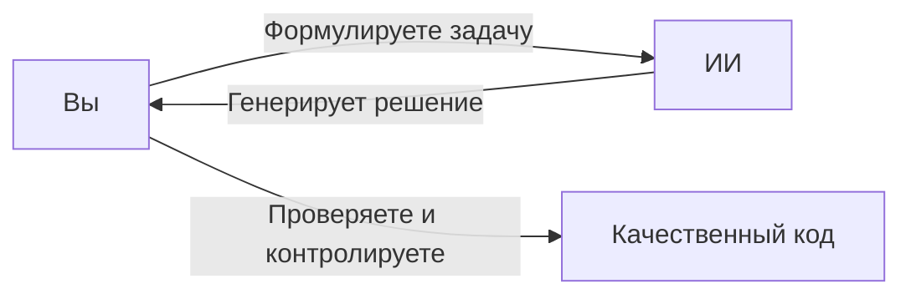

# Финальные рекомендации по ИИ-программированию

Если после всего курса у вас осталось ощущение, что «ИИ — это просто способ писать код быстрее», значит вы недооценили масштаб происходящего.

ИИ — это не просто ускоритель. Это инструмент, который может:

- резко повысить вашу эффективность
- или так же резко разрушить ваш проект

Разница — в том, как вы с ним работаете.

## ИИ делает ровно то, что вы ему разрешили

Это фундаментальная мысль, которую многие игнорируют:

::: danger
ИИ не «сам решил». Вы ему это позволили.
:::

### Пример с коммитами

Вы можете настроить процесс так, что ИИ:

- делает коммиты автоматически
- не делает их вообще
- предлагает изменения, но не применяет

И каждый из этих вариантов может быть правильным или катастрофическим — в зависимости от контекста.

### Почему это важно

Если вы не ограничили область изменений, не задали правила, не контролируете процесс — ИИ начнёт «оптимизировать» всё подряд. И да, иногда это выглядит как переписанный модуль, изменённая архитектура и неожиданные «улучшения».

### Ваша задача

Не «использовать ИИ», а **выстроить свой workflow**, где:

- понятно, что ИИ может делать
- что он не имеет права трогать
- где требуется подтверждение

## Баланс эффективности — это не очевидная штука

Можно:

- всё делать вручную → медленно
- всё отдать ИИ → хаос

Рабочий вариант всегда посередине:

- ИИ генерирует, вы контролируете
- ИИ ускоряет, вы принимаете решения

## Один неосторожный запрос — и проект уехал

Это не преувеличение. Сценарий, который рано или поздно случается у всех:

1. Вы пишете что-то вроде: «улучши это»
2. ИИ переписывает код, меняет структуру, затрагивает соседние части
3. Вы не до конца понимаете, что изменилось
4. Через 10 минут: «а почему теперь ничего не работает?»

## Коммиты — не опция, а страховка

Если вы работаете с ИИ без регулярных коммитов — вы просто играете в рулетку.

### Подход 1: По времени (упрощённый)

Раз в час или через фиксированные интервалы. Подходит для длинных сессий, когда сложно делить на этапы.

### Подход 2: По задачам (предпочтительный)

После каждой небольшой, но завершённой задачи. Например:

- реализована функция
- добавлен endpoint
- исправлен баг

Даже если не идеально, можно улучшить — но уже работает.

::: info
Почему это лучше: у вас есть точки возврата, изменения изолированы, легче отследить, где всё сломалось.
:::

### Но есть нюанс

Коммиты ради коммитов — это такая же плохая идея.

**Плохо:** «Коммитим раз в час, даже если там мусор»

**Хорошо:** «Фиксируем осмысленные изменения»

## Как сочетать это с ИИ

Рабочий процесс:

1. Дали ИИ задачу (ограниченную)
2. Проверили результат
3. Убедились, что код работает и ничего лишнего не сломано
4. Сделали коммит

## Дополнительные рекомендации

### Ограничивайте область изменений

Всегда указывайте, какие файлы можно трогать, а какие нельзя.

### Проверяйте дифф

Перед применением смотрите, что именно изменилось. ИИ иногда «немного помогает» там, где его не просили.

### Не доверяйте слепо

Работает — не значит правильно работает.

### Фиксируйте правила

Через `.cursorrules`, документацию, спецификации.

## Итог

ИИ-программирование — это не про «меньше думать». Это про:

- быстрее реализовывать
- но с тем же уровнем контроля

::: success
ИИ — это инструмент, который либо делает вас кратно эффективнее, либо кратно ускоряет создание проблем.

Разница между этими сценариями — не в модели, не в Cursor и не в настройках. Она в одном: **контролируете ли вы процесс — или просто наблюдаете, как он происходит**.
:::
