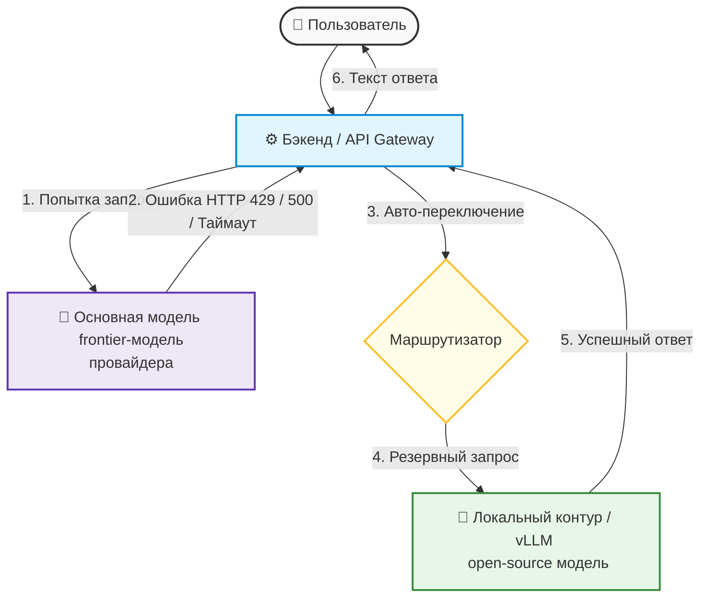
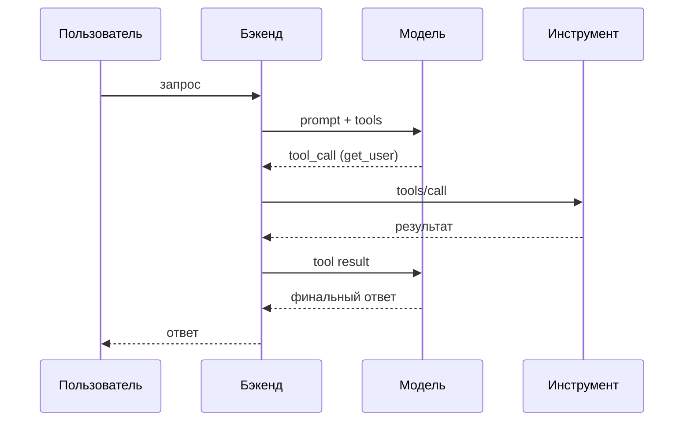

# Надёжность и наблюдаемость

Как не падать под нагрузкой и видеть, что происходит в проде: лимиты RPM/TPM, очереди, retry/backoff, circuit breaker, failover — и наблюдаемость: структурные логи, трейсы многошагового агента, метрики, дрейф качества и алерты.

---

## Жёсткие ограничения продакшена: Что такое RPM и TPM

В процессе локальной разработки и тестирования ИИ-функций инженеры редко сталкиваются со сбоями. Однако при выходе приложения в реальный продакшен, когда им начинают пользоваться сотни людей одновременно, система мгновенно упирается в **Rate Limits (лимиты частоты запросов)** со стороны AI-провайдеров (OpenAI, Anthropic, DeepSeek).

Провайдеры защищают свои серверы от перегрузок и ограничивают приложения по нескольким ключевым метрикам:

1. **RPM (Requests Per Minute):** Максимальное количество *запросов* в минуту. Если лимит равен 30 RPM, то 31-й запрос, отправленный в течение той же минуты, завершится ошибкой.
2. **TPM (Tokens Per Minute):** Максимальное количество *токенов* (суммарно входящих в промпт и исходящих из модели), обрабатываемых в минуту. У Anthropic метрика разделена на **ITPM** (входные) и **OTPM** (выходные токены).
3. **Лимит резкого роста (Acceleration / Burst Limit):** контролирует не объем, а *скорость разгона* трафика. Даже оставаясь в пределах RPM/TPM, можно получить `429 rate_limit_error`, если нагрузка выросла слишком резко, — поэтому наращивают трафик постепенно.

::: info Три факта о лимитах, которые часто спрашивают на собеседованиях: (1) лимиты действуют на уровне организации/проекта, а не каждого пользователя приложения — все ваши клиенты делят общую квоту; (2) неудачный запрос, получивший `429`, тоже расходует минутную квоту, поэтому «долбить» провайдера в плотном цикле бесполезно; (3) лимит «60 RPM» может проверяться окнами короче минуты, поэтому короткий burst способен уронить запрос даже при среднем трафике ниже лимита. Актуальные лимиты смотрите в личном кабинете провайдера (у OpenAI — Settings → Organization → Limits; они растут вместе с суммой пополнений по тарифным уровням). :::

::: danger Главная ловушка TPM: Вы можете отправить всего 2 запроса в минуту (не нарушая RPM), но если в каждом из них содержался гигантский лог или документ на 50 000 токенов, приложение мгновенно заблокируют по TPM с кодом ошибки HTTP `429 Too Many Requests`. :::

### Типовые коды ошибок провайдеров, которые обязан различать инженер

| HTTP-код | Что означает | Повторять запрос? |
| :--- | :--- | :--- |
| **429** `rate_limit_error` | Исчерпан лимит RPM/TPM или сработал burst-лимит | Да, с задержкой из заголовка `Retry-After` или экспоненциальным backoff |
| **503** `service_unavailable_error` | Модель временно перегружена (`server_is_overloaded`) | Да, с задержкой и увеличением паузы при повторах |
| **408 / таймаут** | Провайдер не ответил вовремя | Да, если запрос идемпотентен |
| **401 / 403** | Неверный или отозванный ключ | **Нет** — чинить аутентификацию, не нагружать retry-контур |
| **400** | Некорректное тело запроса (например, превышено контекстное окно) | **Нет** — ошибка в коде приложения, ретрай бессмыслен |

> 💡 **Правило индустрии:** заголовок `Retry-After` из ответа провайдера — это *минимальное* время ожидания. К нему добавляют случайный джиттер (jitter), чтобы тысячи клиентов не «выстрелили» повторами одновременно. Официальные SDK провайдеров уже умеют делать ретраи — не дублируйте их своим вторым циклом повторов, иначе задержки умножатся.

---

## Архитектура стабильности: Очереди и Балансировка

Чтобы приложение не «падало» у конечных пользователей при получении ошибки `429`, на бэкенде выстраивают защитную инженерную архитектуру.

### Реализация очередей запросов (Rate Limiting Queue)
Запросы к ИИ нельзя отправлять в модель напрямую из контроллера «как есть». Между пользователем и ИИ-провайдером ставится брокер сообщений или очередь (например, на базе Redis + BullMQ или RabbitMQ).
* **Как это работает:** Если бэкенд видит, что текущий лимит RPM/TPM исчерпан, он не возвращает пользователю ошибку. Он временно «замораживает» запрос в очереди и выполняет его автоматически через 5–10 секунд, как только счетчик минут у провайдера обнулится.

> 💡 **Порядок срабатывания контуров защиты:** правильный бэкенд обрабатывает сбой по убыванию дешевизны: сначала **очередь/ретрай** (та же модель, пауза по `Retry-After` + backoff с джиттером) → если лимиты или сбой держатся, **fallback на другую модель** → и только затем **бизнес-деградация** (для пользователя: «обработка занимает больше времени, уведомим в чате», сохранение заявки в БД и продолжение без ИИ). Failover — это не первый, а *последний* рубеж перед деградацией.

> ⚠️ **Ловушка повторов:** повтор можно отправлять только если операция **идемпотентна** (безопасно повторить без дубликата). Классический пример из QA-практики: первая попытка сгенерировала ответ и списала токены, но упала при доставке результата клиенту — наивный ретрай сгенерирует и оплатит ответ второй раз.

### Распределение нагрузки (Load Balancing)
Для крупных систем использование одного API-ключа или одного провайдера — это критическая точка отказа. Применяется балансировка: запросы распределяются циклически (Round Robin), по весам (weighted) или по схеме «rate-limit aware» (учитывая оставшиеся квоты ключей) между разными аккаунтами, региональными зеркалами или инстансами моделей. На практике это реализуют готовыми шлюзами-маршрутизаторами (например, LiteLLM Router), а не самописным кодом.

> 💡 **Паттерн Circuit Breaker (предохранитель):** если провайдер начал сыпать ошибками подряд, каждое «пробное» обращение к нему — потерянное время пользователя. Маршрутизатор считает неудачи и после N сбоев за окно времени (allowed_fails) «размыкает цепь»: временно исключает больной инстанс из ротации на cooldown-период, а затем аккуратно возвращает его в строй пробными запросами. Так же устроены автоматические выключатели в электросети.

---

## Стратегия Failover: Автоматический резервный контур

Если у основного провайдера (например, OpenAI) происходит глобальный сбой (Outage), бизнес не должен останавливаться. Продакшен-система должна поддерживать **Failover (автоматическое переключение на резерв)**.

В качестве резервного контура часто выступают легковесные открытые модели (Open-Source), развернутые на собственных серверах компании (Self-hosted) через Ollama или vLLM (например, модели семейства Llama или Mistral).

::: warning Что НЕ переключается на резерв автоматически: failover срабатывает только на *временные* проблемы — 429/503, таймауты, обрывы соединения. Ошибки `401/403` (неверный ключ), `400` (битый запрос) или исчерпанный месячный бюджет чинить переключением провайдера бессмысленно: резервный контур вернет ту же ошибку или породит дубли. Перед включением fallback в проде его прогоняют через Evaluation (оценку): резервная модель должна подтверждать требуемое качество, поддерживать нужные возможности (tools, стриминг) и не нарушать требования по локализации данных. :::

> 💡 **Приоритезация очереди:** в час пик очередь можно вести по приоритетам — платящие пользователи и критичные бизнес-операции идут впереди, фоновые задачи (ночная генерация отчетов) — последними, когда лимиты свободны.

### 🔄 Схема работы отказоустойчивого контура (Failover)

* **Шаг 1:** Бэкенд отправляет запрос пользователя в основную коммерческую модель.
* **Шаг 2:** Модель недоступна или возвращает ошибку превышения лимитов.
* **Шаг 3:** Перехватчик ошибок (Error Interceptor) на бэкенде мгновенно активирует резервный сценарий.
* **Шаг 4:** Запрос автоматически перенаправляется на внутренний сервер компании, где крутится локальная open-source модель.
* **Шаг 5:** Локальная модель генерирует результат (возможно, чуть менее глубокий, но рабочий).
* **Шаг 6:** Пользователь получает ответ без прерывания сессии.

---

## Наблюдаемость: видеть, что происходит в проде

Rate limits и failover отвечают на вопрос «как не упасть». Наблюдаемость отвечает на другой: **почему система ведёт себя именно так и сколько это стоит.** Без неё инцидент разбирается по скриншотам пользователей, а деградация качества замечается через неделю.

### Структурные логи запроса

Каждый вызов модели должен оставлять запись в машиночитаемом виде (JSON), а не в свободном тексте. Минимальный набор полей:

| Поле | Зачем |
| :--- | :--- |
| `trace_id`, `session_id`, `user_id` | Связать вызов с запросом, сессией и пользователем |
| `model`, `model_version` | Понять, какая модель отвечала, и заметить смену версии у провайдера |
| `prompt_version` / хэш промпта | Отличить деградацию промпта от деградации модели |
| `tokens_in`, `tokens_out`, `cached_tokens` | Считать стоимость и оценивать эффективность кэша |
| `latency_ms` (time-to-first-token и полная) | Отделить медленную генерацию от медленной сети или очереди |
| `cost` | Стоимость конкретного вызова, а не «средняя по больнице» |
| `finish_reason` | Понять, обрезан ли ответ по `max_tokens` |
| `retry_count`, `fallback_used` | Увидеть, как часто система работает «на резерве» |
| `error_code` | Отличить 429 от 400 и от таймаута |
| `tool_calls` (имя, статус, длительность) | Разобрать многошаговый сценарий |

Правила: ПДн и секреты маскируются; промпт и ответ не логируются целиком без необходимости (это дорого и небезопасно); `trace_id` передаётся во все внутренние вызовы.

### Трейсы многошагового агента

Финальный ответ ничего не говорит о том, **как** он получен. Агент мог вызвать пять инструментов, дважды повторить неудачный запрос и один раз сходить в запрещённый сервер. Поэтому нужен трейс — последовательность шагов с таймингами и атрибутами:

В трейсе видно: имя инструмента, аргументы (с маскированием), длительность, статус, номер шага, был ли retry. Это позволяет ответить на вопросы «почему агент зациклился», «почему ответ дорогой», «почему операция не выполнилась».

Инструменты класса observability: OpenTelemetry (спаны и атрибуты, совместимость с APM), LangSmith, Langfuse, Arize Phoenix. Для курса важно понимать **класс**, а не конкретный вендор: трейс LLM-вызова — это не то же самое, что лог приложения.

### Метрики

| Метрика | Что показывает | Типичный сигнал |
| :--- | :--- | :--- |
| **p50 / p95 латентности** | Пользовательский опыт, а не среднее | p95 выше SLO — деградация |
| **Доля ошибок** (5xx, 429, таймауты) | Стабильность | Рост 429 — лимиты или всплеск трафика |
| **Success rate бизнес-операции** | Дошёл ли сценарий до результата | Падение при стабильных 200 — проблема в качестве |
| **Доля fallback** | Как часто работает резерв | Рост — основной провайдер деградирует |
| **Стоимость на сессию** | Экономика | Скачок — вырос контекст или зациклился агент |
| **Токены на запрос** | Эффективность промпта | Рост без роста полезности — раздутый контекст |
| **Доля ошибок инструментов** | Качество интеграций | Один инструмент сыпет — проблема в нём, не в модели |
| **Срабатывания guardrails** | Безопасность | Всплеск — попытка атаки или ложные срабатывания |

Средние значения обманывают: смотрите перцентили и разрезы (модель, тип запроса, инструмент, клиент).

### Дрейф качества

Провайдер может обновить модель без изменения названия, а качество на ваших задачах — измениться. Заметить это можно только измерением: периодический прогон **golden set** (блок 3, тема 6) и сравнение с baseline. Если score упал ниже порога — алерт, а не «пользователи пожалуются».

Практика:

* храните baseline по модели, промпту и версии набора;
* прогоняйте набор по расписанию (ночью) и перед сменой модели/промпта;
* отделяйте дрейф модели от дрейфа данных: изменились входные запросы или качество ответов;
* для критичных сценариев — canary: 5–10% трафика на новую версию, сравнение метрик, откат при регрессии.

### Алерты: что инцидент, а что шум

| Считать инцидентом | Считать шумом |
| :--- | :--- |
| Рост доли 429/5xx выше порога за 5–10 минут | Единичный 500 или один медленный запрос |
| Падение success rate бизнес-операции | Отдельный retry, завершившийся успехом |
| Скачок стоимости на сессию в 2–3 раза | Плановый рост трафика в рабочие часы |
| p95 латентности выше SLO | Кратковременный всплеск при деплое |
| Падение score golden set ниже baseline | Колебание в пределах погрешности |
| Всплеск срабатываний guardrails на инъекции | Ложное срабатывание, разобранное по логу |

Алерт без runbook — это шум: непонятно, что делать и кто отвечает. Для каждого инцидента заранее определяется действие: отключить модель, переключить fallback, ограничить трафик, откатить промпт.

### Чем отличаются логи приложения и трейсы LLM

| | Логи приложения | Трейсы LLM-вызова |
| :--- | :--- | :--- |
| **Что фиксируют** | Запросы, ошибки, бизнес-события сервиса | Промпт, модель, токены, стоимость, шаги агента, инструменты |
| **Зачем** | Диагностика сервиса | Диагностика качества, стоимости и поведения модели |
| **Инструменты** | Лог-платформы, APM | OpenTelemetry + LLM-трейсинг, LangSmith/Phoenix/Langfuse |
| **Связь** | Общий `trace_id` | Тот же `trace_id` + спаны шагов |

Оба нужны: по логам приложения видно, что упало, по трейсу — почему модель повела себя именно так и во сколько это обошлось.

---

## Зачем это знать ИТ-специалистам разного профиля?

* **Разработчику:** Вы обязаны оборачивать каждый вызов ИИ в блоки обработки специфичных кодов ошибок (особенно HTTP `429` и `503`). Вы настраиваете экспоненциальную задержку повторных запросов (Exponential Backoff) и конфигурируете прокси-серверы для балансировки токенов. Плюс вы отвечаете за структурные логи и трейсы: `trace_id`, модель, версия промпта, токены, стоимость и шаги агента — без них инцидент разбирается по догадкам.
* **Аналитику:** Вы закладываете метрики пропускной способности в требования. Рассчитывая стоимость фичи, вы должны составить прогноз: сколько токенов в среднем будет генерировать один пользователь и какой тарифный план у провайдера нужно выкупить, чтобы избежать деградации сервиса в часы пик. Туда же — требования к наблюдаемости: какие метрики и пороги считаются инцидентом, кто реагирует на алерт и что делает.
* **QA-инженеру:** Нагрузочное тестирование (Load / Stress Testing) становится специфичным. Вы должны искусственно симулировать ситуацию превышения лимитов (например, отправлять 100 тяжелых запросов в секунду) и проверять: корректно ли бэкенд ставит задачи в очередь, срабатывает ли Failover-переключение на резервную модель и не дублируются ли списания денег со счетов пользователей при повторных попытках ИИ. Отдельно проверяются трейсы (виден ли каждый шаг и стоимость), алерты (срабатывают ли на реальный инцидент и не шумят ли) и дрейф качества после смены модели.

---

## Шпаргалка для собеседования

* В чем разница между лимитами RPM и TPM у ИИ-провайдеров и какой из них сложнее контролировать?

<b>👉 Посмотреть правильный ответ</b>

<b>RPM</b> контролирует количество сетевых запросов в минуту, его легко отслеживать простыми счетчиками на бэкенде. <b>TPM</b> ограничивает суммарный объем токенов (вход + выход) за минуту. Контролировать TPM сложнее, так как размер ответа модели заранее неизвестен, и один тяжелый запрос с большим контекстом может мгновенно исчерпать минутную квоту для всего приложения.

* Как ведет себя архитектура Failover (отказоустойчивости), если основной коммерческий провайдер ИИ уходит в офлайн?

<b>👉 Посмотреть правильный ответ</b>

При падении основного провайдера бэкенд-приложение перехватывает код ошибки или таймаут с помощью специальной прослойки (Middleware) и автоматически перенаправляет поток запросов на резервное зеркало. Чаще всего это другая коммерческая модель-аналог либо собственная open-source модель (например, из семейства Llama), развернутая на инфраструктуре компании. Для пользователя сервис продолжает работать, сохраняя непрерывность бизнес-процесса.

* Каким образом очередь запросов на бэкенде помогает обрабатывать ошибку HTTP 429 Too Many Requests?

<b>👉 Посмотреть правильный ответ</b>

Вместо того чтобы транслировать ошибку 429 конечному пользователю, бэкенд перехватывает её и помещает упавший запрос обратно в очередь (например, в Redis/BullMQ). Система выдерживает технологическую паузу (используя алгоритм Exponential Backoff), а затем автоматически повторяет попытку отправки, когда лимиты времени у провайдера обновятся. Пользователь замечает лишь небольшую задержку ответа, но не сталкивается со сбоем системы.

* Чем структурный лог отличается от трейса и что фиксировать в каждом?

<b>👉 Посмотреть правильный ответ</b>

Лог — это события: <code>trace_id</code>, <code>session_id</code> и <code>user_id</code>; модель и её версия; версия или хэш промпта; токены in/out и доля кэша; латентность (включая time-to-first-token); стоимость вызова; <code>finish_reason</code>; число повторов и факт fallback; код ошибки; список вызовов инструментов со статусом и длительностью. ПДн и секреты маскируются, запись идёт в машиночитаемом JSON. Трейс — это последовательность шагов агента: какие инструменты вызывались, с какими аргументами, где произошёл retry и сколько стоил каждый шаг (спаны OpenTelemetry; класс инструментов — LangSmith, Langfuse, Phoenix). Финальный ответ не показывает, как он получен, поэтому без трейса нельзя разобрать зацикливание, неожиданную стоимость или пропущенное подтверждение; лог и трейс связываются общим <code>trace_id</code>.

* Как заметить, что качество модели упало после обновления у провайдера?

<b>👉 Посмотреть правильный ответ</b>

Только измерением: периодический прогон golden set и сравнение с baseline по модели, промпту и версии набора. Провайдер может обновить модель без смены названия, поэтому нужен мониторинг score и алерт при падении ниже порога. Дополнительно — canary на 5–10% трафика при смене модели или промпта, разделение дрейфа модели и дрейфа входных данных, быстрый откат при регрессии.

* Чем алерт на инцидент отличается от шума и почему алерт без runbook бесполезен?

<b>👉 Посмотреть правильный ответ</b>

Инцидент — это устойчивый сигнал: рост доли 429/5xx за окно, падение success rate бизнес-операции, скачок стоимости на сессию, нарушение p95 SLO, падение score golden set, всплеск срабатываний guardrails. Шум — единичный 500, один медленный запрос, retry, завершившийся успехом, плановый рост трафика. Алерт без runbook бесполезен, потому что непонятно, что делать и кто отвечает; для каждого инцидента заранее определено действие — отключить модель, переключить fallback, ограничить трафик или откатить промпт.

