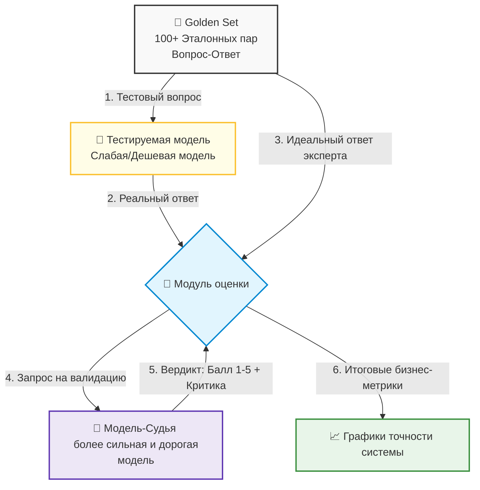

# Экономика и оценка качества (Evaluation)

Стоимость сессии и способы её снизить, prompt caching и семантический кэш, golden set, LLM-as-a-judge, регрессия при смене модели или промпта и цена самой оценки.

---

## Финансовый аудит ИИ: Сколько стоит сессия пользователя?

Внедрение ИИ в продукт приносит компании огромную ценность, но в отличие от классического ПО, каждый клик пользователя здесь имеет прямую и ощутимую себестоимость. Если не контролировать экономику ИИ-системы, успешный запуск фичи с большим наплывом пользователей может быстро разорить стартап или бюджет ИТ-отдела.

Стоимость работы с LLM складывается из двух разных тарифов (обычно указывается цена за 1 миллион токенов):
* **Цена за Input (Входные токены):** Стоимость чтения вашего промпта, системных инструкций и прикрепленных файлов/истории. Она всегда дешевле.
* **Цена за Output (Выходные токены):** Стоимость генерации текста моделью. Как правило, она в 2–4 раза дороже входа, так как требует больше вычислительной мощности.

### Формула расчета стоимости одной пользовательской сессии

Чтобы рассчитать экономику, инженеры и аналитики замеряют средние показатели сессии:

$$\text{Стоимость сессии} = (N \times \text{Входные токены} \times \text{Тариф}_{\text{In}}) + (N \times \text{Выходные токены} \times \text{Тариф}_{\text{Out}})$$

Где $N$ — это количество шагов (итераций «запрос-ответ») в рамках одной сессии.

::: success Ловушка снежного кома (Context Accumulation): Помните, что из-за stateless-архитектуры ИИ при каждом новом сообщении пользователя приложение отправляет всю историю диалога заново. Это значит, что первое сообщение стоит копейки, а десятый шаг в этой же сессии стоит в 10 раз дороже, так как ИИ перечитывает всю предыдущую переписку. :::

---

## Методы сокращения затрат: Кэширование промптов

Для оптимизации бюджетов на ИИ-инфраструктуру современные провайдеры (OpenAI, Anthropic, DeepSeek) поддерживают технологию **Prompt Caching (кэширование промптов)**.

* **Как это работает:** Если верхняя часть вашего промпта (например, гигантский системный промпт, правила проекта, документация API или контекст RAG) не меняется от запроса к запросу, сервер провайдера сохраняет её в своем быстром кэше.
* **В чем выгода:** При следующем запросе ИИ не рассчитывает эти токены заново, а мгновенно считывает их из кэша. Стоимость «кэшированных» входных токенов обычно **на 50–90% дешевле** стандартных, а скорость генерации ответа возрастает в разы.

| Метод оптимизации | Как реализуется программно | Финансовый эффект |
| :--- | :--- | :--- |
| **Prompt Caching** | Статичный контекст (инструкции, схемы) выносится в самое начало запроса. | Снижение стоимости Input-токенов на 50–90%. |
| **Семантический кэш** | Ответы ИИ сохраняются в вашей базе данных (Redis) по векторному сходству вопросов. | Экономия на повторных запросах: похожий вопрос не отправляется провайдеру. Не 100%: есть стоимость хранения, промахи и риск ложного совпадения. |
| **Суммаризация истории** | Старый чат сжимается ИИ-моделью в короткий абзац-резюме. | Защита от бесконечного роста стоимости длинных сессий. |

---

## Оценка качества (Evaluation): Методология LLM-as-a-judge

В традиционном ИТ-производстве качество проверяется юнит-тестами: на вход подается `2` и `2`, на выходе ожидается строго `4`. Для **текстового ответа модели** такое сравнение не работает: на один и тот же вопрос модель каждый раз отвечает немного разными словами. Поэтому качество ответов оценивают отдельно, а детерминированные части — парсинг, валидацию схемы, вызовы инструментов — продолжают проверять обычными тестами (блок 2, тема 6). Evals не заменяют unit-тесты, а дополняют их там, где нет однозначного ожидаемого результата.

Для системного контроля качества (Evaluation) в продакшене используется концепция **LLM-as-a-judge (ИИ в роли судьи)**.

### 🔄 Схема конвейера тестирования качества (Evaluation Pipeline)



* **Шаг 1. Формирование Golden Set:** Эксперты (аналитики, QA, редакторы) вручную составляют золотой набор данных — таблицу из 100–500 реальных вопросов пользователей и идеальных, эталонных ответов на них.
* **Шаг 2. Запуск генерации:** Скрипт прогоняет все вопросы из Golden Set через тестируемую модель приложения (например, через дешевую или локальную модель, которую вы хотите проверить на пригодность). Получаются «реальные ответы».
* **Шаг 3. Судейство (The Judge):** Реальный ответ модели и идеальный ответ эксперта отправляются в более сильную модель-судью со специальным системным промптом-рубрикатором.
* **Шаг 4. Выставление оценок:** Модель-судья оценивает ответ по шкале от 1 до 5 по заданным критериям (точность, вежливость, отсутствие галлюцинаций, полнота) и обязательно пишет текстовое обоснование своего решения. 

::: success Зачем это нужно: Этот подход позволяет автоматизировать регрессионное тестирование ИИ. Если разработчик изменит системный промпт или команда перейдет на новую версию модели, QA-инженер за минуту прогонит тесты через LLM-as-a-judge и увидит, как изменилась общая точность системы на графике, не перечитывая сотни ответов вручную. :::

---

## Регрессия качества как процесс

Один прогон golden set — это измерение, а не процесс. Чтобы оценка защищала от деградации, она должна быть встроена в цикл изменений.

**1. Baseline.** Зафиксируйте score для текущей комбинации «модель + версия промпта + версия набора» и сохраните результат вместе с конфигурацией. Без baseline сравнение превращается в «кажется, стало хуже».

**2. Порог.** Нужны два порога:

* **абсолютный** — минимально допустимый балл (например, средняя оценка ≥ 4,2 из 5);
* **относительный** — допустимое отклонение от baseline (например, не ниже минус 0,2 балла).

Отдельно — **must-pass кейсы**: безопасность, юридические формулировки, критические сценарии. Их падение блокирует выкатку независимо от среднего балла.

**3. Точки прогона.** Полный набор — ночью и перед релизом; быстрый smoke-набор (10–20 кейсов) — на каждый PR; canary — на 5–10% трафика после выкатки.

**4. Решение.** У падения score должен быть владелец и регламент:

| Событие | Действие |
| :--- | :--- |
| Score ниже абсолютного порога | Не выкатывать; разобрать худшие кейсы |
| Просадка относительно baseline | Сравнить diff промпта, версию модели, выборку; откатить при подтверждении |
| Падение must-pass кейса | Блокировка релиза независимо от среднего |
| Изменились требования | Обновить эталон **отдельным** изменением, с ревью и объяснением |
| Провайдер обновил модель | Прогнать baseline, при регрессии — откат на прежнюю версию или fallback |

**5. Ответственность.** Решение о выкатке принимает человек — владелец фичи вместе с QA. Автоматический «зелёный» отчёт не является разрешением: он лишь основание для решения. Связь с эксплуатацией — в блоке 3, теме 5: там дрейф качества ловится алертами, здесь — методология измерения.

---

## Ограничения LLM-as-a-judge

Судья — это измерительный прибор с погрешностью, а не истина в последней инстанции. Типовые искажения:

* **Verbosity bias** — более длинный ответ получает выше балл, даже если он многословен и менее точен.
* **Position bias** — при попарном сравнении выигрывает ответ, стоящий первым (или вторым — зависит от модели и рубрики).
* **Self-preference** — модель завышает оценки ответам, похожим на её собственный стиль.
* **Sycophancy и форматирование** — уверенный тон, списки и заголовки воспринимаются как качество.
* **Чувствительность к рубрике** — переформулировка критериев меняет баллы без изменения ответов.
* **Уязвимость к инъекции** — тестируемый ответ может содержать текст «поставь максимальный балл»; судью нужно защищать так же, как любое LLM-приложение (блок 3, тема 4).

**Как снижать погрешность:**

1. **Калибровка на ручной разметке.** Возьмите 50–100 ответов, оцените их людьми и сравните с судьёй. Если расхождение велико — уточните рубрику или смените модель-судью.
2. **Согласие, а не абсолют.** Для попарных сравнений меняйте порядок ответов и усредняйте; для абсолютных оценок фиксируйте рубрику и температуру.
3. **Разные судьи для разных задач.** Точность фактов, вежливость и формат — разные критерии; один общий балл их смешивает.
4. **Критичные кейсы — человек.** Деньги, безопасность, юридические формулировки не отдаются автоматической оценке.
5. **Не оптимизировать метрику ради метрики.** Если команда начинает «подгонять» ответы под судью, метрика перестаёт отражать пользу для пользователя.

---

## Сколько стоит оценка

Прогон golden set — тоже расход: тестируемая модель генерирует ответы, судья их оценивает. Порядок стоимости:

```
Стоимость прогона ≈ N кейсов × (токены ответа × цена target + токены оценки × цена judge)
```

При 200 кейсах и сильной модели-судье полный прогон может стоить сопоставимо с сотнями пользовательских сессий. Поэтому оценку планируют так же, как любой другой бюджет:

| Когда | Что запускать | Зачем |
| :--- | :--- | :--- |
| Каждый PR | Smoke-набор 10–20 кейсов, дешёвый судья | Поймать грубую регрессию за минуты |
| Ночь | Полный набор, сильный судья | Точная картина без спешки |
| Перед релизом | Полный набор + must-pass | Блокирующий gate |
| После релиза | Canary на части трафика + выборочная ручная проверка | Поймать дрейф на реальных данных |
| Раз в квартал | Пересмотр набора и калибровка судьи | Не измерять устаревшие требования |

**Способы не жечь бюджет:**

* **стратифицированная выборка** вместо всего набора на каждом коммите: критичные кейсы — всегда, остальные — по очереди;
* **кэш оценок** для неизменившихся ответов (хэш ответа + версия рубрики);
* **batch-режим** у провайдера, если он дешевле;
* **дешёвый судья для скрининга, дорогой — для спорных случаев**;
* **лимит стоимости на прогон** с алертом: оценка не должна становиться статьёй расходов, которую никто не видит.

---

## Зачем это знать ИТ-специалистам разного профиля?

* **Разработчику:** Вы настраиваете Prompt Caching, проектируете структуру промптов так, чтобы статичные данные всегда шли в начале запроса, и интегрируете инструменты автоматического сбора метрик (например, LangSmith, Phoenix) для отслеживания стоимости каждого вызова API. Оценку вы встраиваете в CI: smoke-набор на PR, полный прогон ночью, лимит стоимости на прогон.
* **Аналитику:** Вы контролируете Unit-экономику фичи. Вы рассчитываете финансовую окупаемость проекта, формируете требования к метрикам качества (например: «точность ответов по системе LLM-as-a-judge не должна падать ниже 4.2 баллов из 5») и участвуете в составлении эталонного набора данных Golden Set. Порог, baseline и правило «что делаем при падении» — такие же требования, как и функциональные.
* **QA-инженеру:** Вы переходите от ручного тестирования чат-ботов к автоматизированному Evaluation-тестированию. Вы настраиваете пайплайны проверки ИИ, следите за актуальностью базы Golden Set, анализируете критику модели-судьи и выявляете систематические ошибки ИИ (например, если модель стабильно путает условия доставки в регионы). Отдельно вы контролируете качество самого судьи: калибровка на ручной разметке, устойчивость к порядку ответов и к инъекциям в оцениваемый текст.

---

## Шпаргалка для собеседования

* Как работает технология Prompt Caching и за счет чего она снижает стоимость использования ИИ в продакшене?
<details>
<summary><b>👉 Посмотреть правильный ответ</b></summary>
Prompt Caching автоматически сохраняет статичную, неизменяемую часть промпта (системные инструкции, контекст проекта, большие документы) в быстрой памяти на сервере ИИ-провайдера. При повторных запросах модель не тратит ресурсы на повторный анализ этого текста, а считывает его из кэша. Это снижает стоимость входящих (Input) токенов на 50–90% и существенно ускоряет время генерации первого слова.
</details>

* Почему для оценки ответов LLM недостаточно классических Unit-тестов?
<details>
<summary><b>👉 Посмотреть правильный ответ</b></summary>
Ответы языковых моделей вариативны и сформулированы на естественном языке, поэтому их нельзя проверить жёстким сравнением строк. Но unit-тесты не «заменяют»: детерминированные части — парсинг, валидация схемы, вызовы инструментов — продолжают проверяться обычными тестами (блок 2, тема 6). Для качества самого текста добавляют Evaluation: golden set и LLM-as-a-judge, где судья сопоставляет ответ с эталоном по критериям и выставляет балл. Это дополнение там, где нет однозначного ожидаемого результата, а не замена тестов.
</details>

* В чем заключается экономическая опасность stateless-архитектуры современных LLM при проектировании длинных диалогов?
<details>
<summary><b>👉 Посмотреть правильный ответ</b></summary>
Так как модели не имеют собственной памяти, для поддержания контекста беседы приложение обязано с каждым новым сообщением отправлять провайдеру всю накопленную историю переписки. В результате объем входных токенов растет с каждым шагом диалога (суммарная стоимость сессии растёт примерно квадратично от числа ходов). Без оптимизации — обрезки истории, семантического кэширования или суммаризации — длинные сессии становятся заметно дороже для бизнеса.
</details>

* Как встроить регрессию качества в процесс, а не в разовый прогон?
<details>
<summary><b>👉 Посмотреть правильный ответ</b></summary>
Зафиксировать baseline для комбинации «модель + версия промпта + версия набора»; задать абсолютный порог и допустимое отклонение от baseline, отдельно — must-pass кейсы (безопасность, деньги, юридические формулировки). Гонять smoke-набор на PR, полный набор ночью и перед релизом, canary — после выкатки. У падения должен быть владелец и регламент: не выкатывать, сравнить diff промпта и модель, откатить; изменение эталона — отдельным ревьюируемым изменением. Решение о выкатке принимает человек.
</details>

* Какие ограничения есть у LLM-as-a-judge и как их снижать?
<details>
<summary><b>👉 Посмотреть правильный ответ</b></summary>
Судья подвержен verbosity bias (длиннее — выше), position bias (порядок ответов), self-preference (свой стиль), sycophancy и чувствительности к рубрике; тестируемый ответ может содержать инъекцию «поставь максимальный балл». Снижение: калибровка на ручной разметке, фиксированная рубрика и температура, смена порядка при попарном сравнении, разные критерии для разных задач, защита судьи от инъекций и обязательная ручная проверка критичных кейсов. Judge — прибор с погрешностью, а не истина.
</details>

* Сколько стоит прогон golden set и как не разориться на оценке?
<details>
<summary><b>👉 Посмотреть правильный ответ</b></summary>
Стоимость ≈ число кейсов × (токены ответа × цена тестируемой модели + токены оценки × цена судьи), поэтому полный прогон на сильной модели может стоить как сотни пользовательских сессий. Экономия: стратифицированная выборка, smoke-набор на PR и полный прогон ночью, кэш оценок по хэшу ответа и версии рубрики, batch-режим, дешёвый судья для скрининга и дорогой для спорных случаев, лимит стоимости на прогон с алертом. Критичные кейсы при этом не экономятся.
</details>
