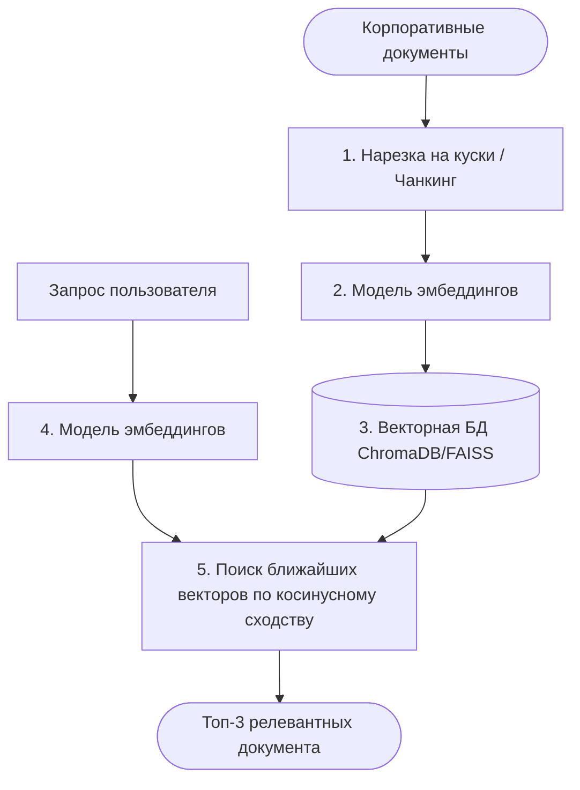

# Эмбеддинги и векторные базы данных

Как ИИ ищет информацию не по ключевым словам, а по смыслу. Превращение текста в математические векторы, работа с векторными хранилищами и быстрый старт на лёгких решениях вроде ChromaDB и FAISS.

---

## Почему старый добрый поиск по ключевым словам больше не работает

Раньше поиск в информационных системах строился на **лексическом подходе** (Keyword Search). Система искала точное совпадение букв и подстрок. 

Если пользователь вводил запрос *«Где найти спецификацию к API?»*, классический поиск искал документы, содержащие слова «спецификацию» и «API». Если нужный документ назывался *«Документация к интерфейсу программирования приложений»*, система его **не находила**, хотя по смыслу это идеальный ответ.

### Ограничения классического поиска
* **Синонимы:** не понимает, что «автомобиль», «машина» и «транспортное средство» — это одно и то же в контексте.
* **Контекст:** не различает омонимы (например, слово «ключ» в значении «родник», «гаечный ключ», «ключ шифрования» или «ключ от двери»).
* **Опечатки и языковые формы:** ломается, если пользователь изменил падеж или допустил ошибку, а в базе нет точной словоформы.


Современная ИИ-разработка решает эту проблему через **семантический поиск** (Semantic Search) — поиск по смыслу, а не по буквам.

---

## Что такое эмбеддинги: превращаем смысл в математику

Чтобы компьютер мог сравнивать смыслы, их нужно оцифровать. Для этого используется **модель эмбеддингов** (Embedding Model) — специальная нейросеть, которая превращает любой кусок текста в массив чисел фиксированной длины. Этот массив называется **вектором (или эмбеддингом)**.

::: success Главное правило эмбеддингов
**Если два текста близки по смыслу, то их числовые векторы в многомерном пространстве будут находиться рядом друг с другом.**
:::

Представьте себе координатную сетку смыслового пространства. Модель эмбеддингов (например, от OpenAI, Cohere или open-source варианты с Hugging Face) раскидывает фразы по разным кластерам в зависимости от их истинного значения:

```mermaid
graph TD
    subgraph ИТ и Программирование (Кластер А)
        A1["● 'Спецификация к API'"] --- A2["● 'Документация к интерфейсу'"]
    end
    
    subgraph Кулинария (Кластер Б)
        B1["● 'Рецепт яблочного пирога'"]
    end
    
    A1 ===|Расстояние маленькое: похожи по смыслу| A2
    A1 -.->|Расстояние огромное: разные темы| B1
```

В реальности таких осей (измерений) не две, а гораздо больше. Например, вектор модели `text-embedding-3-small` имеет **1536 измерений** (чисел в массиве), что позволяет нейросети улавливать тончайшие полутона человеческой речи.

> 💡 Размерность — не всегда константа. Современные модели (OpenAI `text-embedding-3-*`, Voyage, открытые модели с Matryoshka Representation Learning) позволяют **укорачивать вектор** (например, до 512 или 256 измерений) почти без потери качества: первые измерения несут «суть» смысла, последние — тонкие детали. Это инструмент экономии памяти и ускорения поиска, о котором стоит упомянуть на собеседовании.

---

## Как ИИ сравнивает векторы

Когда у нас есть два вектора, мы можем математически рассчитать расстояние между ними. Самый популярный метод в ИИ-инженерии — **косинусное сходство (Cosine Similarity)**.

Математика здесь простая: измеряется угол между двумя векторами в многомерном пространстве.

* Если векторы направлены в одну сторону (угол 0°), их косинус равен **1** — тексты максимально близки по смыслу.
* Если векторы перпендикулярны (угол 90°), косинус равен **0** — тексты никак не связаны по смыслу (*«код на Python»* и *«купить диван»*).
* Косинус **-1** (угол 180°) означает противоположное *направление* векторов, а не «противоположный смысл» текстов. На практике отрицательные значения в эмбеддингах почти не встречаются: модели обучаются на схожих контекстах, поэтому даже антонимы («горячий» и «холодный») получают высокое сходство, а произвольные пары текстов дают значение около нуля.

::: warning Частое заблуждение на собеседованиях
Не говорите, что «косинус −1 означает противоположный смысл текстов». Это неверно: антонимы употребляются в похожих контекстах, и эмбеддинг-модели ставят их рядом (исследования лексической семантики, например IWCS 2023, подтверждают: модели дают антонимам умеренно-высокое сходство). Семантический поиск измеряет *тематическую близость*, а не логическую противоположность — поэтому система не отличит «включить отопление» от «выключить отопление» по одному лишь вектору. Для таких кейсов нужны дополнительные механизмы (фильтры, reranking, гибридный поиск).
:::

```mermaid
graph LR
    subgraph Косинусное сходство = 0.95 (Близко)
        V1[Вектор: 'Где дока по API?'] --> U1[Угол острый]
        V2[Вектор: 'Интерфейс разработки'] --> U1
    end
    subgraph Косинусное сходство = 0.12 (Далеко)
        V3[Вектор: 'Ошибка авторизации'] --> U2[Угол около 90°]
        V4[Вектор: 'Рецепт шарлотки'] --> U2
    end
```

Для расчета расстояний в коде разработчики используют простые математические библиотеки или встроенный функционал баз данных, не вычисляя формулы вручную.

---

## Зачем нужны векторные базы данных (Vector DB)

Если у вас в базе данных лежит 100 документов, вы можете быстро перевести их в векторы и сравнить с запросом пользователя с помощью обычного цикла на Python. Но если документов **100 000** или **10 000 000**, то сравнивать запрос пользователя с каждым вектором по очереди (метод перебора Brute Force) будет слишком долго. Пользователь не будет ждать ответ по 30 секунд.

Для решения этой проблемы созданы **векторные базы данных**. Они не просто хранят массивы чисел, а строят по ним специальные **индексы** для сверхбыстрого приближенного поиска ближайших соседей (**ANN — Approximate Nearest Neighbors**).

Платой за скорость становится небольшая неточность: ANN не гарантирует нахождение абсолютного ближайшего вектора, но на практике находит правильную «окрестность» за миллисекунды. Под капотом чаще всего работают два семейства алгоритмов:

* **HNSW (Hierarchical Navigable Small World):** строит многослойный граф «знакомств» между векторами. Поиск начинается с верхних «быстрых» слоёв и спускается всё точнее. Стандарт де-факто в современных БД (Qdrant, Weaviate, ChromaDB, pgvector) — быстрый и точный, но прожорливый по памяти.
* **IVF (Inverted File):** пространство делится на кластеры (ячейки), при запросе просматриваются только ближайшие кластеры. Часто комбинируется со сжатием **PQ (Product Quantization)** — «упаковкой» векторов для экономии RAM. Так работает FAISS на миллиардах векторов.

Знать названия этих алгоритмов нужно каждому: их параметры (`ef_search`, `nprobe`) прямо влияют на баланс «скорость ↔ точность ↔ память», который инженеры крутят в продакшене.

Они делятся на два типа:

### Лёгкие решения «из коробки» (In-Memory / Local)
Идеально подходят для MVP, небольших проектов, пет-проектов и работы на локальной машине разработчика.

* **FAISS (Facebook AI Similarity Search):** Мощная open-source библиотека от Meta. Это не полноценная БД, а чистый, максимально быстрый и оптимизированный индекс на C++. Работает в оперативной памяти. Отлично подходит, когда нужно быстро развернуть поиск по готовому массиву векторов без сложной инфраструктуры.
* **ChromaDB:** Легковесная, встраиваемая (embedded) база данных, созданная специально для AI-приложений и пайплайнов с LLM. Поднимается одной строчкой кода на Python, умеет сама под капотом вызывать модели эмбеддингов, сохраняет данные на диск и идеально интегрируется с фреймворками LangChain и LlamaIndex. Нюанс, который любят проверять на собеседованиях: если не указать модель явно, ChromaDB по умолчанию использует маленькую локальную модель `all-MiniLM-L6-v2` (384 измерения, обучена на английском) — для русскоязычных данных её нужно менять на мультиязычную.

### Тяжелые решения для продакшена
Используются в рабочей эксплуатации, где важны масштабируемость, управление доступом и надёжность. Основные варианты: **Pinecone** (управляемый облачный сервис, «zero-ops»), **Qdrant**, **Milvus**, **Weaviate** (открытые СУБД, которые можно развернуть у себя), а также **pgvector** — расширение для классической СУБД PostgreSQL.

На собеседовании полезно показать понимание выбора: **pgvector** — самый популярный первый шаг в продакшене, если компания уже использует PostgreSQL (отдельная инфраструктура не нужна, данные живут в обычной БД с SQL-фильтрами и транзакциями). Специализированные векторные БД берут, когда векторов становятся десятки миллионов и больше, критична фильтрация по метаданным (сильнее всего у Qdrant) или нужен гибридный поиск «из коробки» (Weaviate).

---

## Архитектура семантического поиска в коде

Типичный пайплайн семантического поиска на базе ChromaDB выглядит следующим образом:



---

## Зачем это знать ИТ-специалистам разного профиля?

* **Разработчику:** Вам нужно будет настраивать этот пайплайн. Главная инженерная задача — правильно выбрать размер «чанка» (куска текста) и величину перекрытия (Overlap), чтобы при нарезке документов не терялся контекст, а также выбрать метрику расстояния (`l2`, `cosine` или `ip` — задаётся при создании коллекции и меняется только пересозданием).
* **Аналитику:** Вы проектируете требования к поиску. Вы должны понимать ограничения эмбеддингов (например, они плохо ищут точные серийные номера, артикулы товаров или даты) и закладывать в архитектуру **гибридный поиск** (Hybrid Search = семантика + ключевые слова, обычно через BM25; результаты двух поисков объединяются алгоритмом RRF), если бизнесу нужен комбинированный сценарий. Также помните: чанки наследуют доступ исходного документа, и при настройке векторной БД нужно исключить попадание закрытых документов в выдачу (см. тему «Безопасность кода и данных»).
* **QA-инженеру:** Тестировать семантический поиск сложнее, чем обычный. Вам придется проверять релевантность выдачи не по факту «есть слово или нет», а по метрикам (**Recall@K** — нашли ли нужный документ в топ-K, **MRR** — насколько высоко он стоит) на заранее подготовленном наборе «вопрос → правильный документ», и следить за тем, чтобы в топ поиска не пролезали документы, похожие по тону, но чуждые по смыслу.

---

## Шпаргалка для собеседования

* Как работает семантический поиск и чем он отличается от поиска по ключевым словам?
<details>
<summary><b>👉 Посмотреть правильный ответ</b></summary>
Поиск по ключевым словам ищет точные совпадения символов и подстрок, поэтому ломается на синонимах и опечатках. Семантический поиск переводит текст в математические векторы (эмбеддинги) с помощью нейросети и ищет документы по сходству смыслов в многомерном пространстве, вычисляя расстояние между векторами (например, через косинусное сходство). Это позволяет находить документы, даже если в них нет ни одного слова из запроса пользователя.
</details>

* Что такое косинусное сходство (Cosine Similarity) и для чего оно применяется в векторных базах данных?
<details>
<summary><b>👉 Посмотреть правильный ответ</b></summary>
Это математическая метрика, которая измеряет угол между двумя векторами в многомерном пространстве. В векторных БД она используется для оценки смысловой близости текстов. Значение, близкое к 1, означает, что векторы направлены в одну сторону, а значит, тексты максимально близки по смыслу. Это главный инструмент ранжирования документов при семантическом поиске.
</details>

* В чем разница между библиотекой FAISS и базой данных ChromaDB? Когда что выбрать?
<details>
<summary><b>👉 Посмотреть правильный ответ</b></summary>
FAISS от Meta — это низкоуровневая, сверхбыстрая библиотека на C++ для эффективного поиска ближайших соседей в оперативной памяти, она не имеет встроенного управления документами, метаданными или автоматического вызова эмбеддингов. ChromaDB — это полноценная легковесная документо-ориентированная векторная база данных «из коробки», которая умеет хранить и векторы, и текст, и метаданные, поддерживает фильтрацию и сама управляет интеграцией с моделями эмбеддингов. Для быстрого AI-приложения на Python выбирают ChromaDB, для работы со сжатыми огромными массивами чистых векторов на низком уровне — FAISS.
</details>

* Как выбрать модель эмбеддингов для своего проекта? Почему нельзя смешивать векторы разных моделей?
<details>
<summary><b>👉 Посмотреть правильный ответ</b></summary>
Критерии выбора: <b>язык данных</b> (модель должна быть обучена на нужных языках — например, дефолтная модель ChromaDB <code>all-MiniLM-L6-v2</code> знает только английский, для русского берут мультиязычные модели вроде <code>BGE-M3</code> или <code>multilingual-e5</code>), <b>размерность</b> и качество (сверяются с открытым бенчмарком MTEB), <b>стоимость и лимит входа</b> (у коммерческих моделей цена за 1M токенов, лимит контекста — например, 8192 токена у OpenAI-эмбеддингов: длинный чанк нужно резать до индексации), <b>условия размещения</b> (данные нельзя отправлять во внешний API — тогда нужна локальная open-source модель). Главное правило: <b>одна база — одна модель</b>. Векторы разных моделей живут в разных «смысловых пространствах»: сравнивать вектор запроса одной модели с векторами документов другой бессмысленно, а смена модели означает полную переиндексацию всей базы.
</details>
