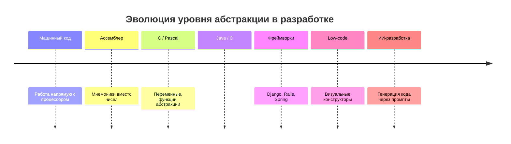

# Эволюция от машинного кода к ИИ-разработке. ИИ-программирование vs вайб-кодинг

Почему навык управления ИИ сегодня критически важен: смена парадигмы разработки, разница между хаотичной генерацией кода («вайб-кодинг») и системным инженерным подходом, и что это означает для карьеры.

---
## Эволюция инструментов: история повторяется

Каждое новое поколение инструментов объявляли «игрушками» для не-настоящих программистов — и каждый раз скептики проигрывали.

### Эпоха 1: Машинный код и ассемблер

Самое начало. Программист:

- работал напрямую с инструкциями процессора
- управлял памятью вручную
- писал код, максимально близкий к железу

Ассемблер стал первым «упрощением». Реакция «старой школы» тогда звучала примерно так:

> «Настоящие программисты пишут в машинных кодах. Ассемблер — это уже костыль.»

Аргументы были знакомые: «ты не понимаешь, что происходит на самом деле», «это снижает контроль», «так нельзя писать серьёзные системы».

Ирония в том, что ассемблер в итоге стал стандартом на долгие годы.

### Эпоха 2: Высокоуровневые языки (C, Pascal и другие)

Появляются языки, где есть переменные, функции, абстракции. Программист больше не думает в регистрах и переходах.

Реакция:

> «Это всё игрушки. Там нет контроля над памятью. Это для студентов.»

Потом приходит язык C — и внезапно операционные системы, компиляторы, серьёзные продукты начинают писаться на нём.

### Эпоха 3: Управляемые среды и ООП (Java, C#, Python)

Следующий скачок: сборка мусора, классы, абстракции поверх абстракций.

И снова:

> «Это медленно. Это неэффективно. Настоящие системы так не пишут.»

Тем временем корпоративные системы, веб-сервисы, огромные платформы спокойно живут на этих «несерьёзных» технологиях.

### Эпоха 4: Фреймворки и высокоуровневые экосистемы

Здесь начинается настоящий культурный кризис. Появляются Django, Rails, Spring. Теперь разработчик не пишет всё с нуля, использует готовые решения, работает на уровне бизнес-логики.

Реакция:

> «Вы вообще не понимаете, как это работает внутри. Это магия, а не программирование. В продакшене такое не живёт.»

::: details Как всё было на самом деле
Спойлер: живёт. И ещё как. Фреймворки стали стандартом индустрии, а «настоящие программисты», писавшие всё с нуля, оказались в меньшинстве.
:::

### Эпоха 5: Low-code / No-code

Тут у многих окончательно сдают нервы:

> «Теперь уже точно всё, профессия умерла.»

Но реальность: сложные системы по-прежнему требуют инженеров. Просто часть задач уходит на более высокий уровень.

### Эпоха 6: Программирование с помощью ИИ

И вот мы здесь. Теперь разработчик может генерировать код, анализировать ошибки, проектировать системы в диалоге.

Реакция «старой школы» звучит подозрительно знакомо:

> «Это не программирование. Они ничего не понимают. ИИ всё делает за них.»

История буквально повторяется. Даже формулировки не меняются.

## Почему это происходит каждый раз и что на самом деле меняется

Потому что с каждым новым уровнем абстракции:

- **снижается порог входа**
- **увеличивается скорость разработки**
- **меняется роль программиста**

И это пугает тех, кто инвестировал годы в старый стек и строил идентичность вокруг «сложности».

Меняется не сложность, а **её расположение**.

Раньше сложность была в синтаксисе и низком уровне. Теперь — в архитектуре, в управлении системой, в принятии решений.

## Почему ИИ — текущая вершина эволюции

Потому что он делает следующий логичный шаг: убирает необходимость писать большую часть кода вручную.

Но:

- не убирает необходимость думать
- не убирает архитектуру
- не убирает ответственность

ИИ ускоряет реализацию, помогает исследовать решения, снижает рутину.

## Иллюзия «это стало проще»

Снаружи кажется: «ну теперь-то любой может программировать».

На практике:

- **Без подготовки:** хаотичный код, отсутствие структуры, зависимость от генерации
- **С подготовкой:** быстрые и качественные системы, контроль архитектуры, предсказуемость

::: details Почему грамотный подход может быть таким же сложным, как машинный код
Высокий уровень абстракции не убирает сложность — он требует более высокого уровня мышления.

Работа с ИИ на серьёзном уровне включает:

- управление контекстом
- формализацию задач (spec-first)
- декомпозицию систем
- контроль архитектуры
- проверку результатов

Это не «написал промпт и пошёл пить кофе». Это инженерная работа, просто на другом уровне.
:::

## Две манеры работы с ИИ

«Вайб-кодинг» — это когда человек не понимает задачу, не проектирует систему и просто генерирует куски кода, пока «вроде работает»: *«Сделай мне API… ой, не работает… ну почини…»*. Итог предсказуем: код без структуры, хаотичные зависимости, костыли поверх костылей, внезапные баги. **ИИ в этом сценарии — очень быстрый генератор технического долга.**

Грамотная разработка с ИИ выглядит иначе:

1. **Сначала архитектура** — границы модулей, контракты, модели данных.
2. **Потом точная задача ИИ** — не «сделай приложение», а «реализуй слой репозитория с такими-то интерфейсами и ограничениями».
3. **ИИ генерирует код** в рамках продуманной системы.
4. **Человек проверяет, упрощает, интегрирует** и держит целостность.

::: success
ИИ — не источник решений, а ускоритель реализации уже принятых решений.
:::

| Вайб-кодинг | Грамотная разработка с ИИ |
| --- | --- |
| ИИ думает за человека | Человек думает, ИИ помогает |
| Нет архитектуры | Архитектура первична |
| Результат случайный | Результат предсказуемый |
| Быстрый старт, медленный ад | Чуть медленнее старт — зато система живёт |

---

## Почему инженер с ИИ сильнее «обычного пользователя»

ИИ не понимает систему целиком — он видит только тот кусок, который ему дали. Всё, чего у модели нет, приносит инженер:

* **Контекст и системное мышление.** Понимание зависимостей, последствий и масштабирования. «ИИ не ломает архитектуру» — это делает человек, который её не продумал.
* **Умение формулировать задачи.** Разница между «сделай авторизацию» и «реализуй stateless JWT auth с refresh-токенами, ротацией и blacklist» — это пропасть. Качество выхода примерно равно качеству постановки.
* **Критическое мышление.** ИИ генерирует устаревшие решения, ошибается, делает небезопасные вещи. Инженер фильтрует анти-паттерны, проверяет граничные случаи.
* **Чувство архитектуры и компромиссов.** Хороший инженер понимает, где нужна сложность, а где она вредна. ИИ же часто переусложняет или наоборот упрощает до уровня «сломается при первом же росте нагрузки».
* **Управление техдолгом.** Вайб-кодер говорит «потом перепишем» — спойлер: не перепишет. Инженер сразу держит структуру и закладывает расширяемость.

::: danger
ИИ не делает тебя программистом. Он делает тебя быстрее тем, кем ты уже являешься: новичок с ИИ быстрее генерирует мусор, инженер с ИИ быстрее строит системы.
:::

---

## Почему рынок платит за это сегодня

Заказчику не нужен «красивый код» — ему нужен работающий продукт, решающий задачу и сделанный быстро. Два разработчика: один делает за 2 недели, второй за 2 дня — выигрывает второй, если качество сопоставимо.

* **ИИ — усилитель, а не замена.** Сильные разработчики становятся ещё сильнее, слабые быстрее упираются в потолок: ИИ ускоряет выполнение, но не даёт понимания.
* **Скорость стала конкурентным преимуществом.** Команды используют ИИ, сроки сокращаются, ожидания растут. «Медленно, но идеально» превращается в «медленно и невыгодно». Отказ от ИИ = добровольное отставание: коллеги быстрее прототипируют, чинят баги и выпускают фичи.
* **Контроль — обязателен.** Без управления контекстом, формулированием задач и проверкой результата ИИ превращается в генератор проблем. С этим — в мультипликатор эффективности.

---

## Зачем это знать ИТ-специалистам разного профиля?

* **Разработчику:** вы отвечаете за архитектуру и интеграцию ИИ-кода. ИИ пишет — вы проверяете: без понимания системы вы просто быстрее создаёте техдолг, который потом чинить вам.
* **Аналитику:** качество работы ИИ прямо зависит от качества постановки задачи. Умение формализовать требования (spec-first) — ваш главный рычаг управления нейросетью.
* **QA-инженеру:** «работает» не значит «работает правильно». Верификация результата ИИ, проверка граничных случаев и недоверие первому ответу — теперь ваша ежедневная практика.

---

## Шпаргалка для собеседования

* Чем ИИ-программирование отличается от вайб-кодинга?

<b>👉 Посмотреть правильный ответ</b>

Вайб-кодинг — генерация без архитектуры и понимания, результат случайный и обрастает техдолгом. ИИ-программирование — инженерный процесс: сначала архитектура и точная постановка задачи, затем генерация, затем обязательная проверка человеком. ИИ ускоряет реализацию принятых решений, а не заменяет мышление.

* Заменит ли ИИ разработчиков?

<b>👉 Посмотреть правильный ответ</b>

Он усиливает того, кто уже умеет проектировать и проверять. Слабый специалист с ИИ быстрее производит хаос. Поэтому ценность на рынке смещается к навыкам: управление контекстом, формализация задач, контроль результата.

* Почему умение работать с ИИ стало обязательным?

<b>👉 Посмотреть правильный ответ</b>

Рынок платит за скорость и результат. Команды уже используют ИИ, поэтому «принципиально не пользуюсь» означает проигрыш по скорости коллегам. Это очередной виток эволюции инструментов — как высокоуровневые языки и фреймворки в своё время.

