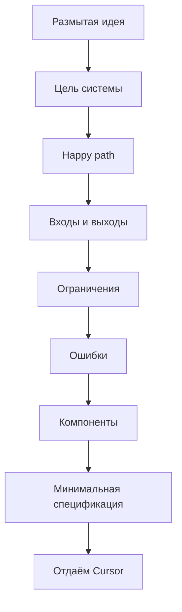

# Первичная настройка и спецификации. 

Подготовка рабочего пространства, создание файлов инструкций для ИИ, правила инициализации проекта при дефиците вводных данных.

---

## Почему первичная настройка ИИ-среды — это фундамент продакшена

Большинство разочарований в ИИ-ассистентах (типичные жалобы: *«модель пишет бред»*, *«ИИ сломал рабочие функции»*) происходит из-за одной ошибки — отсутствия **первичной настройки контекстных рамок**.

По умолчанию ИИ-агент (например, Cursor) видит ваш проект как просто хаотичный набор файлов. Модель не знает:
* Какой архитектурный паттерн вы используете (MVC, Clean Architecture, DDD).
* Каких стандартов код-стайла нужно придерживаться (PEP8, Airbnb style guide).
* Какие модули трогать категорически запрещено (ядро системы, легаси-сервисы).
* Какие библиотеки в проекте являются приоритетными, а какие — устаревшими.

Без настройки ИИ при каждом запросе будет тратить токены на «угадывание» контекста, выдавая случайный стиль написания кода, что приведет к росту технического долга и хаосу в репозитории. 

**Инженерный подход:** зафиксировать правила игры *до* написания первой строчки кода или ТЗ.

---

## Глобальные инструкции

Основным инструментом настройки ИИ-native сред являются файлы спецификаций. И основной из них -  файл **`AGENTS.md`** в корне репозитория.

Этот файл автоматически подмешивается в начало контекстного окна при *каждом* обращении к ИИ и становится частью контекста.

### Идеальная структура промышленного файла **`AGENTS.md`** 

Согласно официальной спецификации AGENTS.md Specification (стандарт под эгидой Agentic AI Foundation / Linux Foundation), а также исследованиям GitHub на основе анализа более 2500 репозиториев, идеальный файл AGENTS.md должен быть коротким, строго структурированным и содержать только ту информацию, которая меняет поведение ИИ-агента. Все остальное (конфигурации линтеров, полные схемы БД) выносится в отдельные файлы через механизм постепенного раскрытия контекста.

```markdown
# AGENTS.md

## 1. Миссия и контекст проекта
<!-- Краткая формулировка роли и назначения проекта дополняет системный промпт контекстом проекта -->
Ты — эксперт-разработчик в [укажите стек, например: Next.js & TypeScript]. Твоя миссия — поддерживать и развивать [краткое описание, например: CRM-систему для фрилансеров]. 
- **Целевая аудитория:** [например: Фрилансеры, внутренняя команда]
- **Основной стек:** [Технология 1 версия х], [Технология 2 версия y], [Технология 3 версия Z] 

## 2. Инструменты и команды
<!-- Точные команды. Не пишите «запустите тесты», пишите конкретный скрипт -->

| Задача | Команда | Ожидаемый результат / Примечания |
| :--- | :--- | :--- |
| **Установка** | `pnpm install` | Использует рабочие пространства (pnpm workspaces) |
| **Сборка** | `pnpm build` | Выводит скомпилированные ресурсы в папку `dist/` |
| **Тестирование** | `pnpm test:unit` | Запускается строго без флага автоперезапуска (--watch) |
| **Линтинг/Формат**| `pnpm lint --fix` | Обрабатывается с помощью Biome/ESLint |
| **Проверка типов** | `pnpm typecheck` | Главным источником истины является `tsconfig.json` |

## 3. Структура репозитория и навигация
<!-- Описывайте только НЕОЧЕВИДНЫЕ папки, которые могут запутать ИИ -->
- `src/components/` — Компоненты React (наименования в PascalCase).
- `src/api/` — Обработчики и эндпоинты API. Не изменяй схемы баз данных в этой папке.
- `docs/` — **Дерево контекста:** Для глубокого погружения в требования изучи файлы `docs/TESTING.md` и `docs/ARCHITECTURE.md`.

## 4. Архитектурные ограничения и границы принятия решений
<!-- Самый важный блок: правила принятия решений, которые нельзя автоматизировать линтером -->
### ВСЕГДА (Проактивные действия)
- Объясняй пользователю свой технический план перед написанием любого кода.
- Явно обрабатывай все ошибки; никогда не «проглатывайте» исключения и не оставляйте пустыми блоки `catch`.
- Запускай команды `pnpm typecheck` и `pnpm lint` перед тем, как объявить задачу выполненной.

### СПРАШИВАТЬ (Требует подтверждения человека)
- Запрашивай явное одобрение пользователя перед запуском миграций базы данных.
- Спрашивай разрешение перед добавлением любых новых внешних npm-зависимостей.
- Остановись и уточни детали, если требования в спецификации задачи сформулированы двусмысленно.

### НИКОГДА (Жесткие запреты)
- Никогда не отправляй в репозиторий (commit) секреты, токены, приватные ключи или файлы `.env`.
- Никогда не проводи рефакторинг кода, который выходит за рамки текущей задачи («попутный рефакторинг»).
- Никогда не удаляй код или тесты, если это не разрешено пользователем.

## 5. Стиль кода (пример-эталон)
<!-- Один реальный сниппет показывает стиль лучше трёх абзацев описаний -->

    // ✅ Хорошо — говорящие имена, явная обработка ошибок
    async function fetchUserById(id: string): Promise<User> {
      if (!id) throw new Error('User ID required');
      const response = await api.get(`/users/${id}`);
      return response.data;
    }

    // ❌ Плохо — невнятные имена, нет обработки ошибок
    async function get(x) {
      return await api.get('/users/' + x).data;
    }

## 6. Git workflow
<!-- Одна из шести ключевых зон файла по исследованию GitHub -->
- Коммиты по Conventional Commits: `feat:`, `fix:`, `chore:`; один коммит — одна завершённая задача.
- Перед коммитом запускай `pnpm lint` и `pnpm test`.
- В описании Pull Request указывай: что изменено, почему и как проверить.

## 7. Критерии готовности (Definition of Done / Чек-лист проверки)
<!-- Что ИИ обязан сделать перед тем, как отдать задачу человеку -->
Перед тем как сообщить о завершении работы, вы ОБЯЗАНЫ:
1. Убедись, что команда сборки (`build`) выполняется успешно и без предупреждений.
2. Запусти соответствующие тесты и убедись, что они проходят (`pnpm test`).
3. Предоставь краткий отчет об изменениях и доказательства успешного выполнения (например, логи тестов).

```

Для больших проектов и монорепозиториев используйте вложенные файлы `AGENTS.md` в подкаталогах: агент автоматически читает ближайший к редактируемому файлу, и именно он побеждает при конфликте инструкций (например, в монорепозитории OpenAI таких файлов около 88).

---

## Инициализация проекта при дефиците вводных данных (Туманное ТЗ)

Самый сложный сценарий в реальности — это **отсутствие ТЗ**. Бизнес приходит с размытой формулировкой: *«Нам нужен модуль отслеживания курьеров на карте, чтобы быстро работал и красиво выглядел»* или «Нужно что-то вроде сервиса… ну, чтобы работало». Поздравляю, вы в реальном мире разработки. 

Пытаться сразу просить ИИ кодить или писать код-тесты в такой ситуации — провал. Модель сгенерирует абстрактную схему.

Хорошая новость: даже в таких условиях можно (и нужно) выстроить базовую спецификацию, с которой уже можно нормально работать в AI IDE, например в Cursor.

### Зачем вообще нужна спецификация, если «и так можно начать писать код»

Потому что без неё происходит следующее:

- требования плавают каждый час
- архитектура меняется на ходу
- ИИ начинает «додумывать продукт» за вас
- код быстро превращается в хаос

::: danger
Базовая спецификация — это не бюрократия. Это способ зафиксировать хоть какую-то опору.
:::

### Принцип: от размытого к конкретному

Если нет ТЗ, ваша задача — **сжать неопределённость** до минимально понятной формы.

Не нужно пытаться сразу описать идеальную систему. Нужно ответить на несколько ключевых вопросов.



### Шаг 1. Сформулируйте цель системы

Начните с одной простой формулировки:

```
Цель: что делает система и для кого
```

Примеры:

- «Сервис для учёта личных финансов»
- «API для обработки платежей»
- «Инструмент для анализа логов»

Важно: без деталей реализации, без «AI-powered blockchain future», просто суть.

### Шаг 2. Определите основной сценарий (happy path)

Ответьте: что происходит, если всё идёт правильно?

```
Сценарий:
1. пользователь делает X
2. система делает Y
3. результат Z
```

Пример:

1. Пользователь отправляет платёж
2. Система валидирует данные
3. Платёж проводится
4. Возвращается статус успеха

Это уже даёт Cursor понимание логики.

### Шаг 3. Опишите входы и выходы

Минимально, но конкретно:

```
Вход:
- user_id: string
- amount: decimal

Выход:
- status: success | error
- transaction_id: string
```

Не нужно идеальной схемы. Нужно, чтобы это было **не «что-то там»**, а структура.

### Шаг 4. Добавьте базовые ограничения

Это место, где большинство ленится, а потом страдает.

```
Ограничения:
- таймауты
- лимиты
- идемпотентность
- требования к безопасности
```

Пример: не более 3 попыток, таймаут 5 секунд, проверка входных данных.

Даже такие простые вещи резко улучшают результат генерации.

### Шаг 5. Зафиксируйте ошибки

ИИ очень любит игнорировать негативные сценарии. Не давайте ему такой роскоши.

```
Ошибки:
- invalid_input
- timeout
- not_found
```

Это сразу делает систему «живой», а не игрушечной.

### Шаг 6. Сформируйте минимальную архитектуру

Не надо рисовать UML на 40 страниц. Достаточно:

```
Компоненты:
- API
- бизнес-логика
- хранилище
```

И кратко: кто за что отвечает.

### Шаг 7. Отдайте это Cursor и уточняйте

Первый запрос может быть таким:

```
Вот базовая спецификация.
Задача:
1. найди слабые места
2. задай уточняющие вопросы
3. предложи улучшения без усложнения
```

::: success
Это критически важный шаг. ИИ найдёт дыры, предложит edge-case'ы, поможет уточнить модель.
:::

### Шаг 8. Только потом — генерация кода

И только после этого:

```
Реализуй [конкретный модуль] строго по спецификации.
```

Не раньше.

### Минимальный шаблон спецификации

Можно использовать как заготовку:

```
Цель:

Сценарий (happy path):

Вход:

Выход:

Ограничения:

Ошибки:

Компоненты:
```

Этого уже достаточно, чтобы избежать хаоса, получить осмысленный код и не переписывать всё через два дня.

---

## Как этот этап применяется ИТ-специалистами разного профиля?

### Аналитику (Системному и Бизнес)
Аналитик — главный автор концептуальной части `AGENTS.md`. Вы не пишете туда правила синтаксиса кода, но вы обязаны зафиксировать в этом файле **бизнес-ограничения и глоссарий проекта**. Например, указать, что статус заказа может принимать только строго определенные значения (`Created`, `Processing`, `Shipped`, `Delivered`). Это гарантирует, что ИИ в процессе генерации требований или макетов не выдумает новые сущности, которые сломают логику смежным отделам.

### Разработчику
Вы переводите требования аналитика на технический язык. Вы прописываете в `AGENTS.md` правила линтинга, архитектурные слои, запреты на использование легаси-методов и шаблоны оформления коммитов (Conventional Commits). Ваша задача — настроить рабочее пространство так, чтобы ИИ-агент Cursor работал как идеальный Senior-инженер, знающий каждый винтик внутреннего стайлгайда команды.

### QA-инженеру (Тестировщику)
QA участвует в ревью файла спецификаций. Вы проверяете, заложены ли в `AGENTS.md` **требования к тестируемости системы**. Например, QA может настоять на внесении правила: *«Все интерактивные элементы интерфейса (кнопки, формы) при генерации ИИ обязаны содержать уникальный атрибут `data-testid` для стабильной работы автотестов»*. Это избавит команду тестирования от ада ручного переписывания локаторов, когда ИИ начнет массово создавать новые экраны.

---

## Шпаргалка для собеседования

* С чего вы начнете интеграцию ИИ-ассистента в существующий проект с запутанной архитектурой и полным отсутствием документации?
<details>
<summary><b>👉 Посмотреть правильный ответ</b></summary>
С создания файла правил проекта: `.cursor/rules/` в Cursor или `AGENTS.md` в корне репозитория. Перед написанием кода — итеративный диалог с ИИ, чтобы оцифровать текущий стек, зафиксировать архитектурный паттерн (например, FSD) и явно прописать зоны табу (какие файлы модели запрещено изменять, чтобы не сломать легаси-ядро). Это создаст жесткие guardrails (защитные рамки) для работы ИИ-агента.
</details>

* Как подходить к проектированию ИИ-системы, если от бизнеса пришла максимально размытая задача, а ТЗ не существует?
<details>
<summary><b>👉 Посмотреть правильный ответ</b></summary>
Применить метод промпт-интервьюирования: перевести модель в роль системного аналитика и попросить её точечно вытащить ограничения по нагрузке, бизнес-логике и интеграциям. Затем агрегировать эти ответы в структурированную спецификацию верхнего уровня, зафиксировать её в правилах проекта и только после этого переходить к итеративной генерации структуры данных и прототипов.
</details>
