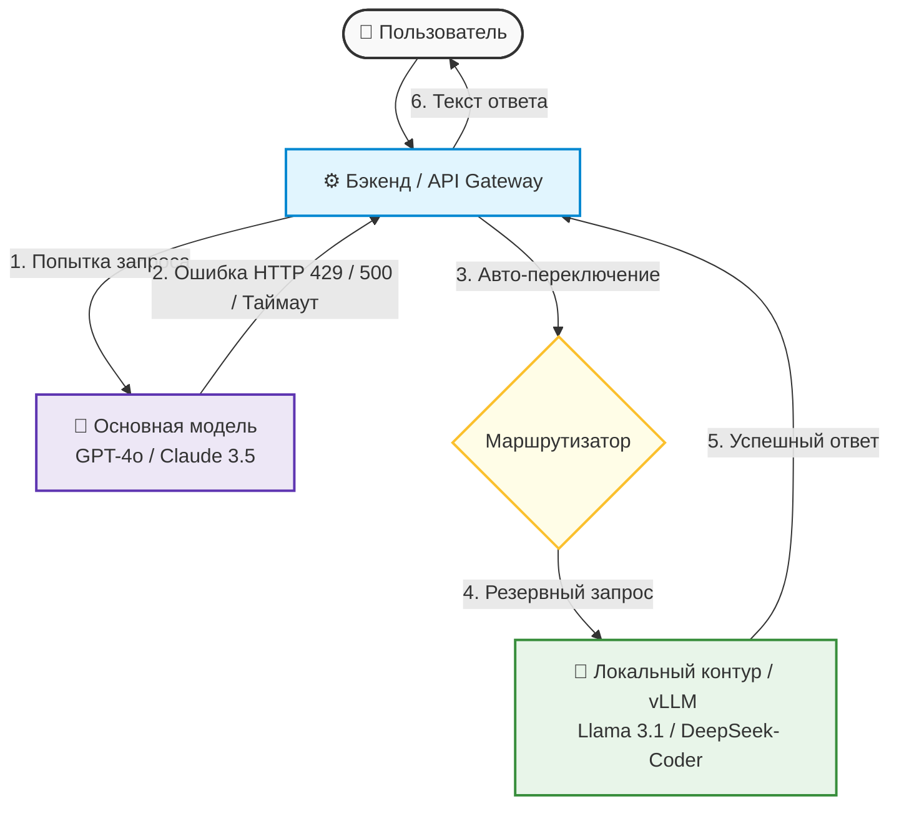

# Инженерный продакшен: Пропускная способность и Ограничения

Практическая борьба с тарифными лимитами (TPM, RPM), проектирование очередей на бэкенде, балансировка нагрузки между провайдерами и обеспечение высокой доступности через автоматическое переключение (Failover).

## Жесткие ограничения продакшена: Что такое RPM и TPM

В процессе локальной разработки и тестирования ИИ-функций инженеры редко сталкиваются со сбоями. Однако при выходе приложения в реальный продакшен, когда им начинают пользоваться сотни людей одновременно, система мгновенно упирается в **Rate Limits (лимиты частоты запросов)** со стороны AI-провайдеров (OpenAI, Anthropic, DeepSeek).

Провайдеры защищают свои серверы от перегрузок и ограничивают приложения по нескольким ключевым метрикам:

1. **RPM (Requests Per Minute):** Максимальное количество *запросов* в минуту. Если лимит равен 30 RPM, то 31-й запрос, отправленный в течение той же минуты, завершится ошибкой.
2. **TPM (Tokens Per Minute):** Максимальное количество *токенов* (суммарно входящих в промпт и исходящих из модели), обрабатываемых в минуту. У Anthropic метрика разделена на **ITPM** (входные) и **OTPM** (выходные токены).
3. **Лимит резкого роста (Acceleration / Burst Limit):** контролирует не объем, а *скорость разгона* трафика. Даже оставаясь в пределах RPM/TPM, можно получить ошибку `429 slow_down`, если нагрузка выросла слишком резко — поэтому наращивают трафик постепенно.

::: info Три факта о лимитах, которые часто спрашивают на собеседованиях: (1) лимиты действуют на уровне организации/проекта, а не каждого пользователя приложения — все ваши клиенты делят общую квоту; (2) неудачный запрос, получивший `429`, тоже расходует минутную квоту, поэтому «долбить» провайдера в плотном цикле бесполезно; (3) лимит «60 RPM» может проверяться окнами короче минуты, поэтому короткий burst способен уронить запрос даже при среднем трафике ниже лимита. Актуальные лимиты смотрите в личном кабинете провайдера (у OpenAI — Settings → Organization → Limits; они растут вместе с суммой пополнений по тарифным уровням). :::

::: danger Главная ловушка TPM: Вы можете отправить всего 2 запроса в минуту (не нарушая RPM), но если в каждом из них содержался гигантский лог или документ на 50 000 токенов, приложение мгновенно заблокируют по TPM с кодом ошибки HTTP `429 Too Many Requests`. :::

### Типовые коды ошибок провайдеров, которые обязан различать инженер

| HTTP-код | Что означает | Повторять запрос? |
| :--- | :--- | :--- |
| **429** `rate_limit_error` | Исчерпан лимит RPM/TPM или сработал burst-лимит | Да, с задержкой из заголовка `Retry-After` или экспоненциальным backoff |
| **503** `service_unavailable_error` | Модель временно перегружена (`server_is_overloaded`) | Да, с задержкой и увеличением паузы при повторах |
| **408 / таймаут** | Провайдер не ответил вовремя | Да, если запрос идемпотентен |
| **401 / 403** | Неверный или отозванный ключ | **Нет** — чинить аутентификацию, не нагружать retry-контур |
| **400** | Некорректное тело запроса (например, превышено контекстное окно) | **Нет** — ошибка в коде приложения, ретрай бессмыслен |

> 💡 **Правило индустрии:** заголовок `Retry-After` из ответа провайдера — это *минимальное* время ожидания. К нему добавляют случайный джиттер (jitter), чтобы тысячи клиентов не «выстрелили» повторами одновременно. Официальные SDK провайдеров уже умеют делать ретраи — не дублируйте их своим вторым циклом повторов, иначе задержки умножатся.

---

## Архитектура стабильности: Очереди и Балансировка

Чтобы приложение не «падало» у конечных пользователей при получении ошибки `429`, на бэкенде выстраивают защитную инженерную архитектуру.

### Реализация очередей запросов (Rate Limiting Queue)
Запросы к ИИ нельзя отправлять в модель напрямую из контроллера «как есть». Между пользователем и ИИ-провайдером ставится брокер сообщений или очередь (например, на базе Redis + BullMQ или RabbitMQ).
* **Как это работает:** Если бэкенд видит, что текущий лимит RPM/TPM исчерпан, он не возвращает пользователю ошибку. Он временно «замораживает» запрос в очереди и выполняет его автоматически через 5–10 секунд, как только счетчик минут у провайдера обнулится.

> 💡 **Порядок срабатывания контуров защиты:** правильный бэкенд обрабатывает сбой по убыванию дешевизны: сначала **очередь/ретрай** (та же модель, пауза по `Retry-After` + backoff с джиттером) → если лимиты или сбой держатся, **fallback на другую модель** → и только затем **бизнес-деградация** (для пользователя: «обработка занимает больше времени, уведомим в чате», сохранение заявки в БД и продолжение без ИИ). Failover — это не первый, а *последний* рубеж перед деградацией.

> ⚠️ **Ловушка повторов:** повтор можно отправлять только если операция **идемпотентна** (безопасно повторить без дубликата). Классический пример из QA-практики: первая попытка сгенерировала ответ и списала токены, но упала при доставке результата клиенту — наивный ретрай сгенерирует и оплатит ответ второй раз.

### Распределение нагрузки (Load Balancing)
Для крупных систем использование одного API-ключа или одного провайдера — это критическая точка отказа. Применяется балансировка: запросы распределяются циклически (Round Robin), по весам (weighted) или по схеме «rate-limit aware» (учитывая оставшиеся квоты ключей) между разными аккаунтами, региональными зеркалами или инстансами моделей. На практике это реализуют готовыми шлюзами-маршрутизаторами (например, LiteLLM Router), а не самописным кодом.

> 💡 **Паттерн Circuit Breaker (предохранитель):** если провайдер начал сыпать ошибками подряд, каждое «пробное» обращение к нему — потерянное время пользователя. Маршрутизатор считает неудачи и после N сбоев за окно времени (allowed_fails) «размыкает цепь»: временно исключает больной инстанс из ротации на cooldown-период, а затем аккуратно возвращает его в строй пробными запросами. Так же устроены автоматические выключатели в электросети.

---

## Стратегия Failover: Автоматический резервный контур

Если у основного провайдера (например, OpenAI) происходит глобальный сбой (Outage), бизнес не должен останавливаться. Продакшен-система должна поддерживать **Failover (автоматическое переключение на резерв)**.

В качестве резервного контура часто выступают легковесные открытые модели (Open-Source), развернутые на собственных серверах компании (Self-hosted) через Ollama или vLLM (например, Llama 3 или Mistral).

::: warning Что НЕ переключается на резерв автоматически: failover срабатывает только на *временные* проблемы — 429/503, таймауты, обрывы соединения. Ошибки `401/403` (неверный ключ), `400` (битый запрос) или исчерпанный месячный бюджет чинить переключением провайдера бессмысленно: резервный контур вернет ту же ошибку или породит дубли. Перед включением fallback в проде его прогоняют через Evaluation (оценку): резервная модель должна подтверждать требуемое качество, поддерживать нужные возможности (tools, стриминг) и не нарушать требования по локализации данных. :::

> 💡 **Приоритезация очереди:** в час пик очередь можно вести по приоритетам — платящие пользователи и критичные бизнес-операции идут впереди, фоновые задачи (ночная генерация отчетов) — последними, когда лимиты свободны.

### 🔄 Схема работы отказоустойчивого контура (Failover)

* **Шаг 1:** Бэкенд отправляет запрос на перевод текста аналитика в основную коммерческую модель.
* **Шаг 2:** Модель недоступна или возвращает ошибку превышения лимитов.
* **Шаг 3:** Перехватчик ошибок (Error Interceptor) на бэкенде мгновенно активирует резервный сценарий.
* **Шаг 4:** Запрос автоматически перенаправляется на внутренний сервер компании, где крутится локальная open-source модель.
* **Шаг 5:** Локальная модель генерирует результат (возможно, чуть менее глубокий, но рабочий).
* **Шаг 6:** Пользователь получает ответ без прерывания сессии.

---

## Зачем это знать ИТ-специалистам разного профиля?

* **Разработчику:** Вы обязаны оборачивать каждый вызов ИИ в блоки обработки специфичных кодов ошибок (особенно HTTP `429` и `503`). Вы настраиваете экспоненциальную задержку повторных запросов (Exponential Backoff) и конфигурируете прокси-серверы для балансировки токенов.
* **Аналитику:** Вы закладываете метрики пропускной способности в требования. Рассчитывая стоимость фичи, вы должны составить прогноз: сколько токенов в среднем будет генерировать один пользователь и какой тарифный план у провайдера нужно выкупить, чтобы избежать деградации сервиса в часы пик.
* **QA-инженеру:** Нагрузочное тестирование (Load / Stress Testing) становится специфичным. Вы должны искусственно симулировать ситуацию превышения лимитов (например, отправлять 100 тяжелых запросов в секунду) и проверять: корректно ли бэкенд ставит задачи в очередь, срабатывает ли Failover-переключение на резервную модель и не дублируются ли списания денег со счетов пользователей при повторных попытках ИИ.

---

## Шпаргалка для собеседования

* В чем разница между лимитами RPM и TPM у ИИ-провайдеров и какой из них сложнее контролировать?

<b>👉 Посмотреть правильный ответ</b>

<b>RPM</b> контролирует количество сетевых запросов в минуту, его легко отслеживать простыми счетчиками на бэкенде. <b>TPM</b> ограничивает суммарный объем токенов (вход + выход) за минуту. Контролировать TPM сложнее, так как размер ответа модели заранее неизвестен, и один тяжелый запрос с большим контекстом может мгновенно исчерпать минутную квоту для всего приложения.

* Как ведет себя архитектура Failover (отказоустойчивости), если основной коммерческий провайдер ИИ уходит в офлайн?

<b>👉 Посмотреть правильный ответ</b>

При падении основного провайдера бэкенд-приложение перехватывает код ошибки или таймаут с помощью специальной прослойки (Middleware) и автоматически перенаправляет поток запросов на резервное зеркало. Чаще всего это другая коммерческая модель-аналог либо собственная open-source модель (например, Llama 3), развернутая на инфраструктуре компании. Для пользователя сервис продолжает работать, сохраняя непрерывность бизнес-процесса.

* Каким образом очередь запросов на бэкенде помогает обрабатывать ошибку HTTP 429 Too Many Requests?

<b>👉 Посмотреть правильный ответ</b>

Вместо того чтобы транслировать ошибку 429 конечному пользователю, бэкенд перехватывает её и помещает упавший запрос обратно в очередь (например, в Redis/BullMQ). Система выдерживает технологическую паузу (используя алгоритм Exponential Backoff), а затем автоматически повторяет попытку отправки, когда лимиты времени у провайдера обновятся. Пользователь замечает лишь небольшую задержку ответа, но не сталкивается со сбоем системы.

