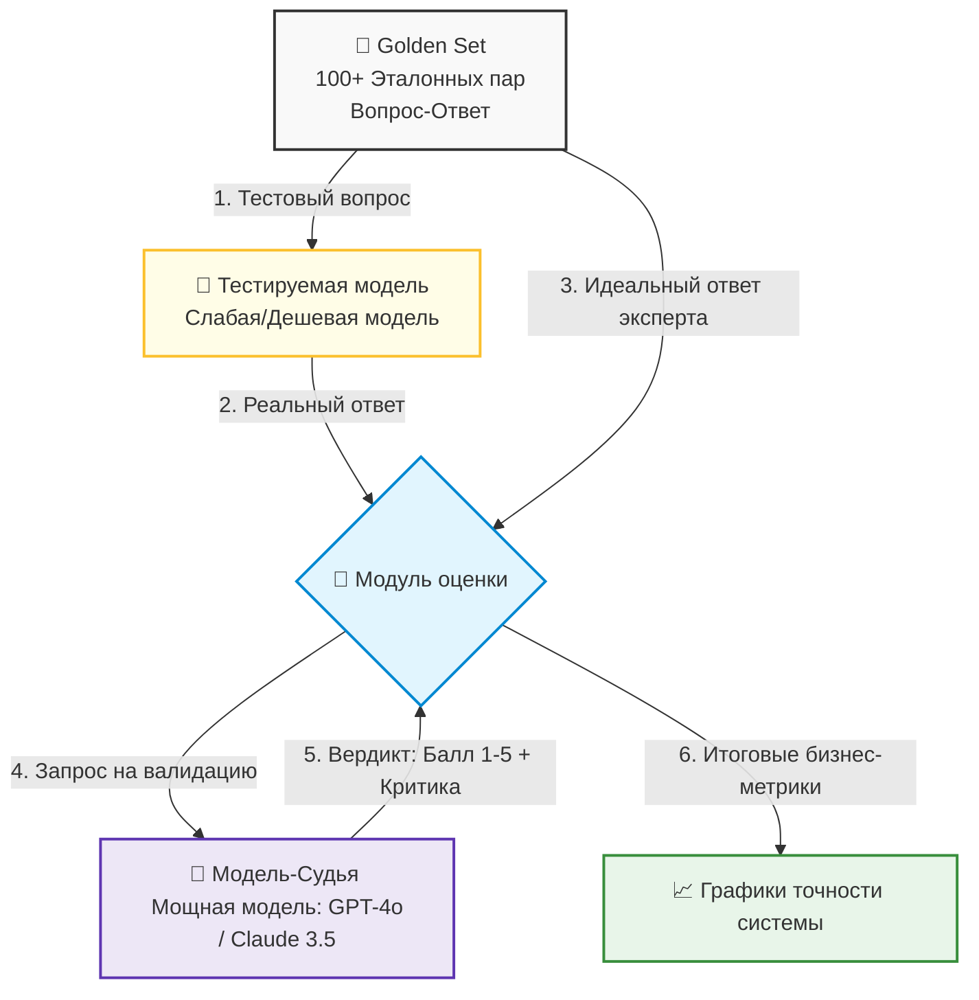

# Экономика и оценка качества ИИ-систем (Evaluation)

Финансовый аудит ИИ-интеграций, методы радикального сокращения затрат на токены через кэширование и автоматизация контроля качества ответов по методологии LLM-as-a-judge на базе эталонных наборов данных.

## Финансовый аудит ИИ: Сколько стоит сессия пользователя?

Внедрение ИИ в продукт приносит компании огромную ценность, но в отличие от классического ПО, каждый клик пользователя здесь имеет прямую и ощутимую себестоимость. Если не контролировать экономику ИИ-системы, успешный запуск фичи с большим наплывом пользователей может быстро разорить стартап или бюджет ИТ-отдела.

Стоимость работы с LLM складывается из двух разных тарифов (обычно указывается цена за 1 миллион токенов):
* **Цена за Input (Входные токены):** Стоимость чтения вашего промпта, системных инструкций и прикрепленных файлов/истории. Она всегда дешевле.
* **Цена за Output (Выходные токены):** Стоимость генерации текста моделью. Она всегда дороже (в 2–4 раза), так как требует больше вычислительной мощности.

### Формула расчета стоимости одной пользовательской сессии

Чтобы рассчитать экономику, инженеры и аналитики замеряют средние показатели сессии:

$$\text{Стоимость сессии} = (N \times \text{Входные токены} \times \text{Тариф}_{\text{In}}) + (N \times \text{Выходные токены} \times \text{Тариф}_{\text{Out}})$$

Где $N$ — это количество шагов (итераций «запрос-ответ») в рамках одной сессии.

::: success Ловушка снежного кома (Context Accumulation): Помните, что из-за stateless-архитектуры ИИ при каждом новом сообщении пользователя приложение отправляет всю историю диалога заново. Это значит, что первое сообщение стоит копейки, а десятый шаг в этой же сессии стоит в 10 раз дороже, так как ИИ перечитывает всю предыдущую переписку. :::

---

## Методы сокращения затрат: Кэширование промптов

Для оптимизации бюджетов на ИИ-инфраструктуру современные провайдеры (OpenAI, Anthropic, DeepSeek) поддерживают технологию **Prompt Caching (кэширование промптов)**.

* **Как это работает:** Если верхняя часть вашего промпта (например, гигантский системный промпт, правила проекта, документация API или контекст RAG) не меняется от запроса к запросу, сервер провайдера сохраняет её в своем быстром кэше.
* **В чем выгода:** При следующем запросе ИИ не рассчитывает эти токены заново, а мгновенно считывает их из кэша. Стоимость «кэшированных» входных токенов обычно **на 50–90% дешевле** стандартных, а скорость генерации ответа возрастает в разы.

| Метод оптимизации | Как реализуется программно | Финансовый эффект |
| :--- | :--- | :--- |
| **Prompt Caching** | Статичный контекст (инструкции, схемы) выносится в самое начало запроса. | Снижение стоимости Input-токенов на 50–90%. |
| **Семантический кэш** | Ответы ИИ сохраняются в вашей базе данных (Redis) по векторному сходству вопросов. | 100% экономия (запрос вообще не отправляется провайдеру, если такой вопрос уже задавали). |
| **Суммаризация истории** | Старый чат сжимается ИИ-моделью в короткий абзац-резюме. | Защита от бесконечного роста стоимости длинных сессий. |

---

## Оценка качества (Evaluation): Методология LLM-as-a-judge

В традиционном ИТ-производстве качество проверяется юнит-тестами: на вход подается `2` и `2`, на выходе ожидается строго `4`. С ИИ этот подход не работает: на один и тот же вопрос модель каждый раз отвечает немного разными словами, и проверить ответ обычным сравнением строк невозможно.

Для системного контроля качества (Evaluation) в продакшене используется продвинутая концепция **LLM-as-a-judge (ИИ в роли судьи)**.

### 🔄 Схема конвейера тестирования качества (Evaluation Pipeline)

* **Шаг 1. Формирование Golden Set:** Эксперты (аналитики, QA, редакторы) вручную составляют золотой набор данных — таблицу из 100–500 реальных вопросов пользователей и идеальных, эталонных ответов на них.
* **Шаг 2. Запуск генерации:** Скрипт прогоняет все вопросы из Golden Set через тестируемую модель приложения (например, через дешевую или локальную модель, которую вы хотите проверить на пригодность). Получаются «реальные ответы».
* **Шаг 3. Судейство (The Judge):** Реальный ответ модели и идеальный ответ эксперта отправляются в самую мощную и дорогую языковую модель (Судью) со специальным системным промптом-рубрикатором.
* **Шаг 4. Выставление оценок:** Модель-судья оценивает ответ по шкале от 1 до 5 по заданным критериям (точность, вежливость, отсутствие галлюцинаций, полнота) и обязательно пишет текстовое обоснование своего решения. 

::: success Зачем это нужно: Этот подход позволяет автоматизировать регрессионное тестирование ИИ. Если разработчик изменит системный промпт или команда перейдет на новую версию модели, QA-инженер за минуту прогонит тесты через LLM-as-a-judge и увидит, как изменилась общая точность системы на графике, не перечитывая сотни ответов вручную. :::

---

## Зачем это знать ИТ-специалистам разного профиля?

* **Разработчику:** Вы настраиваете Prompt Caching, проектируете структуру промптов так, чтобы статичные данные всегда шли в начале запроса, и интегрируете инструменты автоматического сбора метрик (например, LangSmith, Phoenix) для отслеживания стоимости каждого вызова API.
* **Аналитику:** Вы контролируете Unit-экономику фичи. Вы рассчитываете финансовую окупаемость проекта, формируете требования к метрикам качества (например: «точность ответов по системе LLM-as-a-judge не должна падать ниже 4.2 баллов из 5») и участвуете в составлении эталонного набора данных Golden Set.
* **QA-инженеру:** Вы переходите от ручного тестирования чат-ботов к автоматизированному Evaluation-тестированию. Вы настраиваете пайплайны проверки ИИ, следите за актуальностью базы Golden Set, анализируете критику модели-судьи и выявляете систематические ошибки ИИ (например, если модель стабильно путает условия доставки в регионы).

---

## Шпаргалка для собеседования

* Как работает технология Prompt Caching и за счет чего она снижает стоимость использования ИИ в продакшене?

<b>👉 Посмотреть правильный ответ</b>

Prompt Caching автоматически сохраняет статичную, неизменяемую часть промпта (системные инструкции, контекст проекта, большие документы) в быстрой памяти на сервере ИИ-провайдера. При повторных запросах модель не тратит ресурсы на повторный анализ этого текста, а считывает его из кэша. Это снижает стоимость входящих (Input) токенов на 50–90% и существенно ускоряет время генерации первого слова.

* Почему в ИИ-разработке классические Unit-тесты заменяют концепцией LLM-as-a-judge?

<b>👉 Посмотреть правильный ответ</b>

Ответы языковых моделей вариативны, не детерминированы и генерируются на естественном языке, поэтому их невозможно проверить жестким сравнением строк в коде. Концепция LLM-as-a-judge автоматизирует этот процесс: мощная эталонная модель (судья) сопоставляет реальный ответ системы с идеальным ответом из заготовленного тестового набора (Golden Set) по гибким текстовым критериям, выставляя объективный балл и эмулируя проверку реальным человеком.

* В чем заключается экономическая опасность stateless-архитектуры современных LLM при проектировании длинных диалогов?

<b>👉 Посмотреть правильный ответ</b>

Так как модели не имеют собственной памяти, для поддержания контекста беседы приложение обязано с каждым новым сообщением отправлять провайдеру всю накопленную историю переписки. В результате объем входных токенов растет как снежный ком с каждым шагом диалога. Без оптимизации (обрезки истории, семантического кэширования или суммаризации) длинные сессии пользователей становятся экспоненциально дороже для бизнеса.

