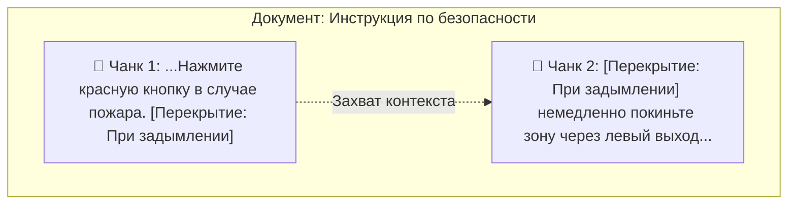
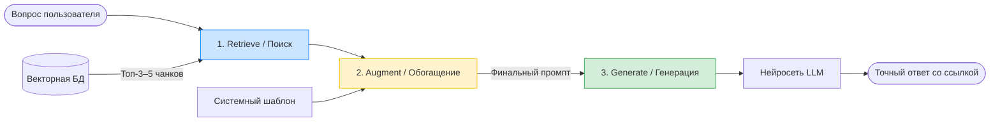

# Chunking и сборка RAG-пайплайна

Как правильно нарезать большие документы на куски (чанки) без потери контекста. Полный цикл работы классического AI-пайплайна: цепочка Retrieve → Augment → Generate. Техника формирования ответов со строгими ссылками на первоисточники для защиты системы от галлюцинаций.

---

## Почему нельзя просто закинуть весь PDF в модель

Казалось бы, если современные LLM обладают огромными контекстными окнами (от 128k до 1M+ токенов), зачем вообще делить документы на части? Загрузил всю базу знаний в контекст и забыл.

Однако в реальном production-приложении этот подход ломается по трем причинам:

*   **Эффект «Потеря в середине» (Lost in the Middle):** Нейросети отлично помнят информацию в самом начале и в самом конце промпта. Если важный факт скрыт на 450-й странице гигантского контекста, модель с высокой вероятностью его проигнорирует. Исследования 2023 года показали этот эффект наглядно; современные модели стали устойчивее, но проблема не исчезла: при заполнении контекстного окна близко к пределу точность работы с фактами из середины падает, и модель начинает опираться в основном на конец промпта.
*   **Высокая стоимость (Token Costs):** Стоимость каждого запроса к коммерческим API (OpenAI, Anthropic) зависит от количества токенов. Пересылать сотни страниц текста при каждом вопросе пользователя — экономическое самоубийство для бизнеса.
*   **Задержка ответа (Latency):** Чем больше промпт, тем дольше модель обрабатывает запрос (Time to First Token). Пользователи не готовы ждать ответ чат-бота по 40–60 секунд.

**Решение:** Нарезка документов на небольшие смысловые куски — **чанки (Chunks)**. База знаний хранится в векторной БД в виде тысяч изолированных чанков, а ИИ-система достает из нее только те 3–5 кусков, которые нужны прямо сейчас.

---

## Стратегии нарезки текста (Chunking Strategies)

Просто нарезать текст по фиксированному количеству символов (например, каждые 500 знаков) нельзя — вы неизбежно разрежете предложение пополам, потеряв подлежащее или числовое значение.

Инженеры используют более продвинутые стратегии:

### 1. Фиксированный размер с перекрытием (Fixed-size Chunking with Overlap)
Текст делится на блоки фиксированного объема (например, 1000 символов), но каждый следующий блок начинается чуть раньше, захватывая конец предыдущего. Это называется **перекрытием (Overlap)**.



*   **Зачем нужен Overlap?** Чтобы семантика (смысл фразы) на стыке двух кусков не разрывалась. Типичные параметры для старта: размер чанка — 512–1024 токена, перекрытие — 10–20% длины чанка (например, 128 токенов при чанке в 1024). В индустрии объемы измеряют именно в токенах, а не в символах: лимиты у эмбеддинг-моделей считаются в токенах, и одна и та же «1000 символов» в разных языках дает разное их количество.

На практике «фиксированный» чанкинг почти всегда делают **рекурсивным**: сплиттер (например, `RecursiveCharacterTextSplitter` в LangChain) сначала пытается резать текст по крупным естественным границам (абзацам), затем по предложениям и только в крайнем случае по отдельным словам. Так фиксированный размер сочетается с сохранением целостности фраз.

### 2. Семантический и структурный чанкинг
Текст нарезается на основе разметки документа. Чанками становятся логические элементы:
*   Абзацы или разделы (Markdown-заголовки `#`, `##`).
*   Элементы списков или таблицы целиком (нельзя разрывать строки одной таблицы на разные чанки).
*   Строки кода (функции или классы целиком).

---

## Анатомия пайплайна: Цепочка Retrieve → Augment → Generate

RAG-система работает как строгий конвейер из трех последовательных шагов. Разберем, что происходит под капотом, когда пользователь вводит вопрос.



### Шаг 1. Retrieve (Извлечение)
Система переводит вопрос пользователя в вектор и делает запрос к векторной базе данных (ChromaDB/FAISS). База возвращает несколько самых близких по косинусному сходству чанков вместе с их метаданными (название файла, номер страницы, автор).

> 💡 На практике между Retrieve и Augment в продвинутых пайплайнах добавляют **гибридный поиск** (семантика + ключевые слова, см. тему «Эмбеддинги и векторные БД») и **реранкинг** — повторное упорядочивание найденных чанков более точной, но медленной моделью. Базовый пайплайн этого не требует: достаточно топ-K семантического поиска.

### Шаг 2. Augment (Обогащение промпта)
Система берет чистый вопрос пользователя и «упаковывает» его в жесткий системный шаблон, подкладывая найденные чанки в качестве железных аргументов.

**Пример технического промпта на этапе Augment:**
```text
Контекст из базы знаний:
---
[Документ: Устав_Компании.pdf, Стр. 14]
Сотрудники компании имеют право на компенсацию фитнеса в размере до 5000 рублей в месяц после прохождения испытательного срока.
---
[Документ: Приказ_Медицина.docx, Стр. 2]
Программа ДМС со стоматологией активируется автоматически в первый рабочий день сотрудника.
---

Используя ТОЛЬКО предоставленный выше контекст, ответь на вопрос пользователя. 
Если ответа нет в контексте, напиши "Я не знаю". Не придумывай ничего от себя.
К каждому факту в своем ответе обязательно прикрепи ссылку на название документа и страницу.

Вопрос: Какие медицинские льготы у меня есть с первого дня работы?
```

### Шаг 3. Generate (Генерация ответа)
Обогащенный промпт отправляется в LLM. Модель не включает свою долговременную память (склонную к галлюцинациям), а работает как умный копирайтер по предоставленному тексту, генерируя точный и безопасный ответ для бизнеса.

---

## Архитектура ссылок на первоисточник: Защита от лжи

Для корпоративных систем (особенно в финтехе, техподдержке или юриспруденции) критически важно, чтобы ответ ИИ можно было верифицировать человеком. Для этого в векторную БД вместе с текстом чанка записывается объект **Metadata** (метаданные).

Когда документ загружается в базу, пайплайн сохраняет его структуру:
```json
{
  "id": "chunk_9482",
  "text": "Программа ДМС со стоматологией активируется автоматически...",
  "metadata": {
    "source_file": "Приказ_Медицина.docx",
    "page_number": 2,
    "department": "HR",
    "updated_at": "2026-01-15"
  }
}
```

Благодаря тому, что эти метаданные передаются в LLM вместе с текстом (как показано на шаге Augment), модель способна автоматически генерировать ссылки в формате Markdown.

**Результат, который видит пользователь:**
> «Ваша программа ДМС, включая стоматологические услуги, активируется автоматически в ваш самый первый рабочий день (Источник: *Приказ_Медицина.docx, Стр. 2*).»

---

## Зачем это знать ИТ-специалистам разного профиля?

*   **Разработчику:** Вы будете писать код чанкинга. Вам нужно знать библиотеки вроде `RecursiveCharacterTextSplitter` из фреймворка LangChain. Вам предстоит следить за метаданными и настраивать парсинг сложных форматов (например, вытаскивать текст из «битых» PDF или сканов с помощью OCR).
*   **Аналитику:** Вы определяете правила нарезки бизнес-требований. Вы должны составить карту источников данных для ИИ и продумать, какие метаданные (теги, уровни доступа пользователей) нужно навесить на чанки, чтобы бот не выдал рядовому сотруднику секретную информацию для топ-менеджмента.
*   **QA-инженеру:** Ваша зона ответственности — тестирование конвейера на стыках. Вам придется проверять сценарии, когда ответ размазан между двумя чанками, оценивать качество работы LLM при наличии «шума» (когда база данных вернула один нерелевантный чанк вместе с правильными) и проверять валидность генерируемых ссылок на документы.

---

## Шпаргалка для собеседования

* Зачем нужно делать перекрытие (Overlap) при нарезке текста на чанки?
<details>
<summary><b>👉 Посмотреть правильный ответ</b></summary>
Перекрытие (Overlap) необходимо для сохранения семантического контекста на границах кусков текста. Если разрезать документ строго по фиксированному числу символов, ключевая мысль, предложение или важная сущность (например, цифра и ее единица измерения) могут разделиться пополам. Перекрытие гарантирует, что контекст конца предыдущего чанка плавно перейдет в начало следующего, и модель эмбеддингов не потеряет смысл при индексации.
</details>

* Опишите, что происходит на каждом этапе цепочки Retrieve → Augment → Generate в RAG-системах.
<details>
<summary><b>👉 Посмотреть правильный ответ</b></summary>
1. <b>Retrieve (Извлечение):</b> Система векторизует запрос пользователя и находит в векторной БД топ наиболее похожих чанков информации.
2. <b>Augment (Обогащение):</b> Найденные куски текста вместе с системными инструкциями ("отвечай только по тексту", "не галлюцинируй") и метаданными склеиваются в один большой финальный промпт.
3. <b>Generate (Генерация):</b> Обогащенный промпт передается в LLM, которая на основе этого контекста генерирует итоговый структурированный ответ для пользователя.
</details>

* Как технически реализуется вывод ссылок на первоисточники в ответах чат-ботов?
<details>
<summary><b>👉 Посмотреть правильный ответ</b></summary>
Это реализуется через механизм метаданных (Metadata). При загрузке и нарезке документов в векторную базу данных вместе с каждым текстом чанка сохраняются его атрибуты: имя файла, URL, номер страницы или параграф. Во время поиска эти метаданные извлекаются вместе с текстом и передаются в скрытом промпте для LLM с инструкцией обязательно указывать эти метаданные в теле ответа. Модель подхватывает их и генерирует итоговый текст со ссылками.
</details>

* Как выбрать размер чанка (Chunk Size)? Что будет, если чанки слишком большие или слишком маленькие?
<details>
<summary><b>👉 Посмотреть правильный ответ</b></summary>
Слишком маленькие чанки теряют контекст: искомая мысль разрезана, и даже найденный кусок не несет полного смысла. Слишком большие — добавляют шум в промпт, повышают стоимость и задержку, а вектор такого чанка «размывается», ухудшая точность поиска. Стартовая точка практики — 512–1024 токена с перекрытием 10–20%. Дальше размер подбирают эмпирически: прогоняя эталонный набор вопросов (Golden Set) по своим документам и конкретной модели эмбеддингов, так как разные модели по-разному чувствительны к размеру чанка.
</details>
